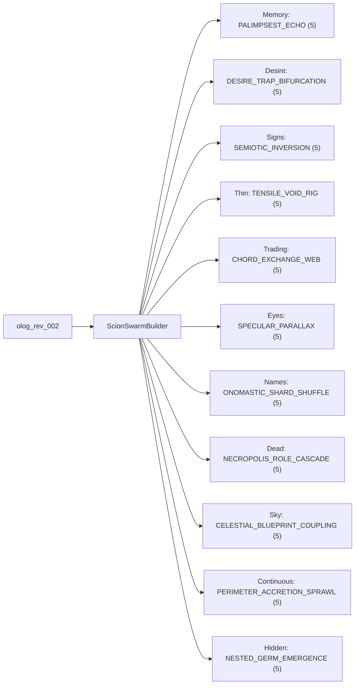

# Atlas of the Fifty-Five Handmade Scion Swarms

> [!IMPORTANT]
> Every one of Calvino's **55 cities** in *Invisible Cities* (Weaver 1974) is compiled by [`ScionSwarmBuilder`](file:///Users/gaia/WORLDFUL/scion_cities/swarms/scion_compiler.py#L469-L629) from [`CITIES_55`](file:///Users/gaia/WORLDFUL/scion_cities/swarms/catalog_55.py#L101-L609) into its own isolated [`PhilogynyAccumulator`](file:///Users/gaia/WORLDFUL/scion_cities/core/accumulator.py#L289-L486) and **4 bespoke `ScionAgent`s** (`220` disjoint agents total; `0.0000` pairwise Jaccard emblem overlap across all `1,485` city pairs).

## 1. The Eleven Swarm Physics Topologies

## 2. Complete 55-City Matrix (`5 Ranks × 11 Series` Across Chapters 1–9)

| Rank | Memory | Desire | Signs | Thin | Trading | Eyes | Names | Dead | Sky | Continuous | Hidden |
| :--- | :--- | :--- | :--- | :--- | :--- | :--- | :--- | :--- | :--- | :--- | :--- |
| **Rank 1** | #01 **Diomira** *(C1)* | #03 **Dorothea** *(C1)* | #06 **Tamara** *(C1)* | #10 **Isaura** *(C1)* | #15 **Euphemia** *(C2)* | #20 **Valdrada** *(C3)* | #25 **Aglaura** *(C4)* | #30 **Melania** *(C5)* | #35 **Eudoxia** *(C6)* | #40 **Leonia** *(C7)* | #45 **Olinda** *(C8)* |
| **Rank 2** | #02 **Isidora** *(C1)* | #05 **Anastasia** *(C1)* | #09 **Zirma** *(C1)* | #14 **Zenobia** *(C2)* | #19 **Chloe** *(C3)* | #24 **Zemrude** *(C4)* | #29 **Leandra** *(C5)* | #34 **Adelma** *(C6)* | #39 **Beersheba** *(C7)* | #44 **Trude** *(C8)* | #49 **Raissa** *(C9)* |
| **Rank 3** | #04 **Zaira** *(C1)* | #08 **Despina** *(C1)* | #13 **Zoe** *(C2)* | #18 **Armilla** *(C3)* | #23 **Eutropia** *(C4)* | #28 **Baucis** *(C5)* | #33 **Pyrrha** *(C6)* | #38 **Eusapia** *(C7)* | #43 **Thekla** *(C8)* | #48 **Procopia** *(C9)* | #52 **Marozia** *(C9)* |
| **Rank 4** | #07 **Zora** *(C1)* | #12 **Fedora** *(C2)* | #17 **Hypatia** *(C3)* | #22 **Sophronia** *(C4)* | #27 **Ersilia** *(C5)* | #32 **Phyllis** *(C6)* | #37 **Clarice** *(C7)* | #42 **Argia** *(C8)* | #47 **Perinthia** *(C9)* | #51 **Cecilia** *(C9)* | #54 **Theodora** *(C9)* |
| **Rank 5** | #11 **Maurilia** *(C2)* | #16 **Zobeide** *(C3)* | #21 **Olivia** *(C4)* | #26 **Octavia** *(C5)* | #31 **Esmeralda** *(C6)* | #36 **Moriana** *(C7)* | #41 **Irene** *(C8)* | #46 **Laudomia** *(C9)* | #50 **Andria** *(C9)* | #53 **Penthesilea** *(C9)* | #55 **Berenice** *(C9)* |

---

## 3. Complete Roster: All 55 Cities & All 220 Handmade Agents

### Chapter 1 (10 Cities)

#### #01 · Diomira — *Cities and memory 1* (Weaver p.7)
- **Swarm Physics**: `PALIMPSEST_ECHO` · **Peak Hash**: `43b2c486ff30` · **Tension**: `32.20`
- **Contradiction Arch**: `α known_silver_taxonomy` ↔ `β september_lamp_envy` *(opposes interchangeable familiar domes)*
- **Optical Rule**: Lead-paved twilight reflection punctured by simultaneous food-stall lamp ignition
- **Urban Loci**: `silver_dome_ring` · `crystal_theater_stalls` · `terrace_balustrade` · **Minted Scars**: `arch_ready`

| Bespoke `ScionAgent` | Bound Locus | Operation | Polarity | Ratio | Material Emblems |
| :--- | :--- | :--- | :--- | :--- | :--- |
| `diomira_silver_domer` | `silver_dome_ring` | `altitude_max` | `known_silver_taxonomy` | `1:1` | `sixty_silver_domes`, `lead_paving`, `golden_cock_tower` |
| `diomira_bronze_pantheon_caster` | `silver_dome_ring` | `emblem_union` | `known_silver_taxonomy` | `5:4` | `bronze_god_statues`, `crystal_theater` |
| `diomira_september_lamp_lighter` | `crystal_theater_stalls` | `polarity_carve` | `september_lamp_envy` | `3:2` | `simultaneous_multicolored_lamps`, `shortening_dusk` |
| `diomira_terrace_cry_envier` | `terrace_balustrade` | `polarity_carve` | `known_silver_taxonomy` | `15:8` | `womans_ooh_cry`, `counterfactual_past_joy` |

#### #02 · Isidora — *Cities and memory 2* (Weaver p.8)
- **Swarm Physics**: `PALIMPSEST_ECHO` · **Peak Hash**: `6372b2647a4b` · **Tension**: `121.38`
- **Contradiction Arch**: `α young_dreamer_spiral` ↔ `β aged_wall_spectator` *(opposes wilderness ride before desire)*
- **Optical Rule**: Nacreous spiral seashell sheen refracted through ground telescope lenses onto bench stone
- **Urban Loci**: `seashell_stairwell` · `luthier_optic_bench` · `old_mens_square_wall` · **Minted Scars**: `arch(old_mens_square_wall:aged_wall_spectator<->young_dreamer_spiral@span=6.04)`, `arch(old_mens_square_wall:aged_wall_spectator<->young_dreamer_spiral@span=6.11)`

| Bespoke `ScionAgent` | Bound Locus | Operation | Polarity | Ratio | Material Emblems |
| :--- | :--- | :--- | :--- | :--- | :--- |
| `isidora_conch_stair_carver` | `seashell_stairwell` | `altitude_max` | `young_dreamer_spiral` | `9:8` | `spiral_staircase`, `encrusted_seashells` |
| `isidora_violin_lens_grinder` | `luthier_optic_bench` | `emblem_union` | `young_dreamer_spiral` | `5:3` | `perfect_telescope`, `resonant_violin`, `third_woman_detour` |
| `isidora_cockpit_brawl_igniter` | `old_mens_square_wall` | `polarity_carve` | `young_dreamer_spiral` | `7:4` | `bloody_cockfight_bet`, `spilled_feathers` |
| `isidora_senescent_wall_seater` | `old_mens_square_wall` | `polarity_carve` | `aged_wall_spectator` | `16:9` | `row_of_old_men`, `desire_already_memory` |

#### #03 · Dorothea — *Cities and desire 1* (Weaver p.9)
- **Swarm Physics**: `DESIRE_TRAP_BIFURCATION` · **Peak Hash**: `a8c64f6b4d82` · **Tension**: `116.50`
- **Contradiction Arch**: `α deductive_monopoly_census` ↔ `β camel_driver_morning_openness` *(opposes monotone caravan desert)*
- **Optical Rule**: Cold brushed aluminum tower glare split by four green canal ribbons and fluttering banners
- **Urban Loci**: `seven_spring_gates` · `nine_canal_quarters` · `trumpet_banner_market` · **Minted Scars**: `arch(trumpet_banner_market:camel_driver_morning_openness<->deductive_monopoly_census@span=5.70)`

| Bespoke `ScionAgent` | Bound Locus | Operation | Polarity | Ratio | Material Emblems |
| :--- | :--- | :--- | :--- | :--- | :--- |
| `dorothea_drawbridge_enumerator` | `seven_spring_gates` | `altitude_max` | `deductive_monopoly_census` | `4:3` | `four_aluminum_towers`, `seven_spring_drawbridges`, `four_green_canals` |
| `dorothea_exogamy_ledger_clerk` | `nine_canal_quarters` | `emblem_union` | `deductive_monopoly_census` | `3:2` | `bergamot`, `sturgeon_roe`, `astrolabes`, `amethysts` |
| `dorothea_brass_platform_trumpeter` | `trumpet_banner_market` | `polarity_carve` | `camel_driver_morning_openness` | `5:4` | `three_trumpet_soldiers`, `turning_wheels`, `colored_banners` |
| `dorothea_direct_gaze_bifurcator` | `trumpet_banner_market` | `polarity_carve` | `deductive_monopoly_census` | `9:5` | `fine_teeth_eye_contact`, `uncounted_desert_paths` |

#### #04 · Zaira — *Cities and memory 3* (Weaver p.10)
- **Swarm Physics**: `PALIMPSEST_ECHO` · **Peak Hash**: `9246b0bc6a25` · **Tension**: `111.55`
- **Contradiction Arch**: `α raw_step_degree_ruler` ↔ `β sponge_event_scar_palimpsest` *(opposes mute geometric mensuration)*
- **Optical Rule**: Zinc-scale roof glint cross-hatched by dawn shadow-lines linking lamppost, railing, and torn net
- **Urban Loci**: `usurper_lamppost` · `nuptial_railing_gutter` · `gunboat_cape_dock` · **Minted Scars**: `arch(usurper_lamppost:raw_step_degree_ruler<->sponge_event_scar_palimpsest@span=5.16)`, `arch(usurper_lamppost:raw_step_degree_ruler<->sponge_event_scar_palimpsest@span=5.29)`

| Bespoke `ScionAgent` | Bound Locus | Operation | Polarity | Ratio | Material Emblems |
| :--- | :--- | :--- | :--- | :--- | :--- |
| `zaira_zinc_arcade_surveyor` | `usurper_lamppost` | `polarity_carve` | `raw_step_degree_ruler` | `6:5` | `stair_streets`, `arcade_curve_degrees`, `zinc_roof_scales` |
| `zaira_gallows_festoon_spanner` | `usurper_lamppost` | `polarity_carve` | `sponge_event_scar_palimpsest` | `4:3` | `swaying_usurper_feet`, `queen_nuptial_festoons` |
| `zaira_dawn_gutter_cat_tracker` | `nuptial_railing_gutter` | `emblem_union` | `sponge_event_scar_palimpsest` | `3:2` | `adulterer_railing_leap`, `tilted_gutter_cat_slip` |
| `zaira_bomb_net_palm_reader` | `gunboat_cape_dock` | `altitude_max` | `sponge_event_scar_palimpsest` | `15:8` | `gunboat_shell_crater`, `swaddling_usurper_myth`, `hand_line_scratches` |

#### #05 · Anastasia — *Cities and desire 2* (Weaver p.12)
- **Swarm Physics**: `DESIRE_TRAP_BIFURCATION` · **Peak Hash**: `340e3c9f36a4` · **Tension**: `123.40`
- **Contradiction Arch**: `α whole_awakened_indulgence` ↔ `β chalcedony_cutter_servitude` *(opposes stifled sequential appetite)*
- **Optical Rule**: Translucent banded agate and cherry-wood smoke beneath concentric canal glints and high kites
- **Urban Loci**: `concentric_kite_canals` · `cherry_pheasant_pool` · `agate_lathe_bench` · **Minted Scars**: `arch(agate_lathe_bench:chalcedony_cutter_servitude<->whole_awakened_indulgence@span=6.40)`

| Bespoke `ScionAgent` | Bound Locus | Operation | Polarity | Ratio | Material Emblems |
| :--- | :--- | :--- | :--- | :--- | :--- |
| `anastasia_kite_canal_ringer` | `concentric_kite_canals` | `altitude_max` | `whole_awakened_indulgence` | `1:1` | `concentric_canals`, `overhead_kites` |
| `anastasia_marjoram_pool_bather` | `cherry_pheasant_pool` | `emblem_union` | `whole_awakened_indulgence` | `5:4` | `cherry_wood_pheasant`, `sweet_marjoram`, `garden_pool_chase` |
| `anastasia_chrysoprase_facet_slave` | `agate_lathe_bench` | `polarity_carve` | `chalcedony_cutter_servitude` | `7:5` | `eight_hour_agate_cut`, `onyx_chrysoprase_dust` |
| `anastasia_desire_form_inverter` | `agate_lathe_bench` | `polarity_carve` | `whole_awakened_indulgence` | `9:8` | `form_stolen_from_desire`, `contented_enslavement` |

#### #06 · Tamara — *Cities and signs 1* (Weaver p.13)
- **Swarm Physics**: `SEMIOTIC_INVERSION` · **Peak Hash**: `8d2306e9cc7b` · **Tension**: `92.50`
- **Contradiction Arch**: `α thick_signboard_discourse` ↔ `β unseen_sub_sign_interior` *(opposes unmarked silent stones and trees)*
- **Optical Rule**: Jutting iron-and-gilt pictographic signboards occluding facades against wind-torn cloud horizon
- **Urban Loci**: `jutting_guild_street` · `temple_decree_plaza` · `empty_cloud_horizon` · **Minted Scars**: `arch(jutting_guild_street:thick_signboard_discourse<->unseen_sub_sign_interior@span=2.90)`, `arch(jutting_guild_street:thick_signboard_discourse<->unseen_sub_sign_interior@span=5.30)`

| Bespoke `ScionAgent` | Bound Locus | Operation | Polarity | Ratio | Material Emblems |
| :--- | :--- | :--- | :--- | :--- | :--- |
| `tamara_emblem_bracket_hanger` | `jutting_guild_street` | `altitude_max` | `thick_signboard_discourse` | `3:2` | `tooth_drawer_pincers`, `tavern_tankard`, `grocer_scales`, `halberds` |
| `tamara_kiosk_taboo_codifier` | `temple_decree_plaza` | `emblem_union` | `thick_signboard_discourse` | `4:3` | `zebra_watering_permit`, `no_kiosk_urination`, `averroes_volumes` |
| `tamara_concealed_core_eraser` | `jutting_guild_street` | `polarity_carve` | `unseen_sub_sign_interior` | `8:5` | `mute_hidden_tamara`, `repeated_city_script` |
| `tamara_pareidolia_cloud_scanner` | `empty_cloud_horizon` | `polarity_carve` | `thick_signboard_discourse` | `15:8` | `cloud_sailing_ship`, `cloud_hand`, `cloud_elephant` |

#### #07 · Zora — *Cities and memory 4* (Weaver p.15)
- **Swarm Physics**: `PALIMPSEST_ECHO` · **Peak Hash**: `697065d70661` · **Tension**: `136.59`
- **Contradiction Arch**: `α immutable_honeycomb_score` ↔ `β entropic_stasis_erasure` *(opposes displaceable forgettable streets)*
- **Optical Rule**: Clear astronomical glass and striped barber cloth frozen in dry air crumbling to chalk dust
- **Urban Loci**: `clock_awning_fountain` · `glass_tower_kiosk` · `hermit_bath_harbor` · **Minted Scars**: `arch(hermit_bath_harbor:entropic_stasis_erasure<->immutable_honeycomb_score@span=6.21)`, `arch(hermit_bath_harbor:entropic_stasis_erasure<->immutable_honeycomb_score@span=6.51)`

| Bespoke `ScionAgent` | Bound Locus | Operation | Polarity | Ratio | Material Emblems |
| :--- | :--- | :--- | :--- | :--- | :--- |
| `zora_copper_score_sequencer` | `clock_awning_fountain` | `emblem_union` | `immutable_honeycomb_score` | `9:8` | `copper_clock`, `striped_barber_awning`, `nine_jet_fountain` |
| `zora_honeycomb_loci_indexer` | `glass_tower_kiosk` | `altitude_max` | `immutable_honeycomb_score` | `5:4` | `astronomer_glass_tower`, `melon_kiosk`, `constellation_cells` |
| `zora_itinerary_lock_warden` | `hermit_bath_harbor` | `polarity_carve` | `immutable_honeycomb_score` | `3:2` | `hermit_lion_statue`, `turkish_bath`, `unalterable_note` |
| `zora_motionless_dust_dissolver` | `hermit_bath_harbor` | `polarity_carve` | `entropic_stasis_erasure` | `16:15` | `languished_masonry`, `earth_forgot_her` |

#### #08 · Despina — *Cities and desire 3* (Weaver p.17)
- **Swarm Physics**: `DESIRE_TRAP_BIFURCATION` · **Peak Hash**: `689949cc360d` · **Tension**: `119.20`
- **Contradiction Arch**: `α overland_steamboat_mirage` ↔ `β seaward_camel_mirage` *(opposes dual sand-tableland and sea-waste)*
- **Optical Rule**: Coastline salt-haze cross-dissolving belching iron smokestacks into spotted camel humps
- **Urban Loci**: `tableland_horizon_ridge` · `harbor_crane_taverns` · `coastline_haze_saddle` · **Minted Scars**: `arch(tableland_horizon_ridge:overland_steamboat_mirage<->seaward_camel_mirage@span=5.80)`

| Bespoke `ScionAgent` | Bound Locus | Operation | Polarity | Ratio | Material Emblems |
| :--- | :--- | :--- | :--- | :--- | :--- |
| `despina_windsock_hull_rigger` | `tableland_horizon_ridge` | `polarity_carve` | `overland_steamboat_mirage` | `5:4` | `skyscraper_pinnacles`, `flapping_windsocks`, `vibrating_iron_keel` |
| `despina_tavern_bottle_brawler` | `harbor_crane_taverns` | `emblem_union` | `overland_steamboat_mirage` | `3:2` | `foreign_crane_cargo`, `broken_flag_bottles`, `lit_window_hair_comb` |
| `despina_hump_saddle_shimmerer` | `tableland_horizon_ridge` | `polarity_carve` | `seaward_camel_mirage` | `7:5` | `glittering_saddle_fringe`, `two_spotted_humps`, `wineskin_packs` |
| `despina_oasis_veil_projector` | `coastline_haze_saddle` | `altitude_max` | `seaward_camel_mirage` | `9:5` | `thick_whitewashed_courts`, `barefoot_veiled_dancers` |

#### #09 · Zirma — *Cities and signs 2* (Weaver p.19)
- **Swarm Physics**: `SEMIOTIC_INVERSION` · **Peak Hash**: `302dce78b746` · **Tension**: `123.10`
- **Contradiction Arch**: `α obsessive_urban_repetition` ↔ `β skeptical_companion_singularity` *(opposes singular unremembered impression)*
- **Optical Rule**: Low-altitude dirigible shadow sweeping across humid subterranean platforms and tattoo ink needles
- **Urban Loci**: `cornice_dirigible_airway` · `cobblestone_puma_arcade` · `humid_subway_tattoo_row` · **Minted Scars**: `arch(cornice_dirigible_airway:obsessive_urban_repetition<->skeptical_companion_singularity@span=7.10)`

| Bespoke `ScionAgent` | Bound Locus | Operation | Polarity | Ratio | Material Emblems |
| :--- | :--- | :--- | :--- | :--- | :--- |
| `zirma_cornice_lunatic_multiplier` | `cornice_dirigible_airway` | `polarity_carve` | `obsessive_urban_repetition` | `6:5` | `window_level_dirigibles`, `teetering_cornice_lunatics` |
| `zirma_puma_leash_echoer` | `cobblestone_puma_arcade` | `emblem_union` | `obsessive_urban_repetition` | `4:3` | `shouting_blind_cane_taps`, `whim_leashed_pumas` |
| `zirma_sailor_ink_puncturer` | `humid_subway_tattoo_row` | `altitude_max` | `obsessive_urban_repetition` | `3:2` | `pierced_tattoo_patterns`, `humid_packed_trains` |
| `zirma_single_witness_pruner` | `cornice_dirigible_airway` | `polarity_carve` | `skeptical_companion_singularity` | `11:8` | `lone_hovering_blimp`, `single_fanning_matron` |

#### #10 · Isaura — *Thin cities 1* (Weaver p.20)
- **Swarm Physics**: `TENSILE_VOID_RIG` · **Peak Hash**: `6eb06eb7f8f0` · **Tension**: `29.80`
- **Contradiction Arch**: `α abyssal_black_lake_cult` ↔ `β ascending_windlass_bucket_cult` *(opposes parched calcareous crust beyond lake rim)*
- **Optical Rule**: Subterranean black-water gleam answered by sunlit airy scaffolding of pipes, pulleys, and weathercocks
- **Urban Loci**: `calcareous_buried_lake` · `thousand_well_shafts` · `stilted_aqueduct_skyline` · **Minted Scars**: `arch_ready`

| Bespoke `ScionAgent` | Bound Locus | Operation | Polarity | Ratio | Material Emblems |
| :--- | :--- | :--- | :--- | :--- | :--- |
| `isaura_subterranean_lake_diviner` | `calcareous_buried_lake` | `polarity_carve` | `abyssal_black_lake_cult` | `1:1` | `buried_black_lake`, `green_perimeter_trace` |
| `isaura_vertical_bore_driller` | `thousand_well_shafts` | `emblem_union` | `ascending_windlass_bucket_cult` | `5:4` | `deep_vertical_wells`, `twisting_trestle_probes` |
| `isaura_noria_pulley_hoister` | `thousand_well_shafts` | `polarity_carve` | `ascending_windlass_bucket_cult` | `3:2` | `suspended_cable_buckets`, `noria_windlasses`, `pump_handles` |
| `isaura_weathercock_stilts_lifter` | `stilted_aqueduct_skyline` | `altitude_max` | `ascending_windlass_bucket_cult` | `2:1` | `stilted_roof_reservoirs`, `slender_aqueducts`, `airy_weathercocks` |

### Chapter 2 (5 Cities)

#### #11 · Maurilia — *Cities and memory 5* (Weaver p.30)
- **Swarm Physics**: `PALIMPSEST_ECHO` · **Peak Hash**: `8f1e5523d3db` · **Tension**: `116.78`
- **Contradiction Arch**: `α sepia_postcard_nostalgia` ↔ `β alien_metropolis_succession` *(opposes continuous self-knowing identity)*
- **Optical Rule**: Harsh concrete overpass glare juxtaposed against sepia halftone grain of white parasols
- **Urban Loci**: `overpass_bandstand_square` · `munitions_parasol_lot` · `departed_lares_threshold` · **Minted Scars**: `arch(overpass_bandstand_square:alien_metropolis_succession<->sepia_postcard_nostalgia@span=5.44)`, `arch(overpass_bandstand_square:alien_metropolis_succession<->sepia_postcard_nostalgia@span=5.50)`

| Bespoke `ScionAgent` | Bound Locus | Operation | Polarity | Ratio | Material Emblems |
| :--- | :--- | :--- | :--- | :--- | :--- |
| `maurilia_postcard_hen_curator` | `overpass_bandstand_square` | `polarity_carve` | `sepia_postcard_nostalgia` | `5:4` | `postcard_square_hen`, `lost_bandstand`, `two_white_parasols` |
| `maurilia_overpass_munitions_builder` | `overpass_bandstand_square` | `polarity_carve` | `alien_metropolis_succession` | `4:3` | `bus_station_concrete`, `steel_overpass`, `munitions_factory` |
| `maurilia_measured_regret_balancer` | `munitions_parasol_lot` | `emblem_union` | `sepia_postcard_nostalgia` | `3:2` | `retroactive_provincial_grace`, `bounded_praise_etiquette` |
| `maurilia_silent_god_replacer` | `departed_lares_threshold` | `altitude_max` | `alien_metropolis_succession` | `7:4` | `homonymous_stranger_city`, `outsider_gods_beneath_names` |

#### #12 · Fedora — *Cities and desire 4* (Weaver p.32)
- **Swarm Physics**: `DESIRE_TRAP_BIFURCATION` · **Peak Hash**: `87118eec782d` · **Tension**: `29.80`
- **Contradiction Arch**: `α gray_stone_necessity` ↔ `β blue_crystal_globe_assumptions` *(opposes single-timeline deterministic urbanism)*
- **Optical Rule**: Cold gray ashlar monolith enclosing dark metal rooms lit from within by ratusan blue glass spheres
- **Urban Loci**: `gray_stone_arterials` · `metal_globe_museum` · `obsolete_utopia_vitrine` · **Minted Scars**: `arch_ready`

| Bespoke `ScionAgent` | Bound Locus | Operation | Polarity | Ratio | Material Emblems |
| :--- | :--- | :--- | :--- | :--- | :--- |
| `fedora_ashlar_necessity_mason` | `gray_stone_arterials` | `polarity_carve` | `gray_stone_necessity` | `1:1` | `gray_stone_metropolis`, `dried_canal_bed`, `banished_elephant_avenue` |
| `fedora_crystal_globe_blower` | `metal_globe_museum` | `polarity_carve` | `blue_crystal_globe_assumptions` | `6:5` | `central_metal_museum`, `miniature_blue_fedora` |
| `fedora_medusa_minaret_modeler` | `obsolete_utopia_vitrine` | `emblem_union` | `blue_crystal_globe_assumptions` | `3:2` | `medusa_reflection_pond`, `canopied_elephant_box`, `pedestalless_spiral_minaret` |
| `fedora_assumption_equalizer` | `metal_globe_museum` | `altitude_max` | `blue_crystal_globe_assumptions` | `9:5` | `outdated_yesterday_future`, `coequal_map_assumptions` |

#### #13 · Zoe — *Cities and signs 3* (Weaver p.34)
- **Swarm Physics**: `SEMIOTIC_INVERSION` · **Peak Hash**: `5de81caf5f59` · **Tension**: `117.10`
- **Contradiction Arch**: `α mental_matrix_of_differences` ↔ `β indivisible_pyramid_promiscuity` *(opposes legible zoned civic hierarchy)*
- **Optical Rule**: Uniform pyramidal roofs under flat shadowless haze erasing palace-from-slum contours
- **Urban Loci**: `pyramid_roof_cluster` · `oracle_bazaar_hearth` · `wolf_wheel_perimeter` · **Minted Scars**: `arch(pyramid_roof_cluster:indivisible_pyramid_promiscuity<->mental_matrix_of_differences@span=6.70)`

| Bespoke `ScionAgent` | Bound Locus | Operation | Polarity | Ratio | Material Emblems |
| :--- | :--- | :--- | :--- | :--- | :--- |
| `zoe_zoning_difference_seeker` | `pyramid_roof_cluster` | `polarity_carve` | `mental_matrix_of_differences` | `4:3` | `expected_prince_palace`, `expected_priest_temple` |
| `zoe_pyramid_function_scrambler` | `pyramid_roof_cluster` | `polarity_carve` | `indivisible_pyramid_promiscuity` | `7:6` | `leprosarium_or_odalisque_bath`, `sleep_forge_cook_reign_same_spot` |
| `zoe_oracle_gold_blender` | `oracle_bazaar_hearth` | `emblem_union` | `indivisible_pyramid_promiscuity` | `5:4` | `simultaneous_gold_and_disrobing`, `mingled_mental_features` |
| `zoe_wolf_howl_border_blurrer` | `wolf_wheel_perimeter` | `altitude_max` | `indivisible_pyramid_promiscuity` | `11:8` | `erased_inside_outside_line`, `wheel_rumble_meets_wolf_howl` |

#### #14 · Zenobia — *Thin cities 2* (Weaver p.35)
- **Swarm Physics**: `TENSILE_VOID_RIG` · **Peak Hash**: `a4b4ed2ade3a` · **Tension**: `149.32`
- **Contradiction Arch**: `α forgotten_founder_plan` ↔ `β recombinatorial_stilt_desire` *(opposes ground-bound desire-erasing cities)*
- **Optical Rule**: Dry terrain crisscrossed by high stilt shadows, zinc-and-bamboo belvederes, and snapping ribbons
- **Urban Loci**: `dry_piling_forest` · `crossed_hanging_sidewalks` · `cone_belvedere_cranes` · **Minted Scars**: `arch(dry_piling_forest:forgotten_founder_plan<->recombinatorial_stilt_desire@span=7.78)`, `arch(dry_piling_forest:forgotten_founder_plan<->recombinatorial_stilt_desire@span=7.89)`

| Bespoke `ScionAgent` | Bound Locus | Operation | Polarity | Ratio | Material Emblems |
| :--- | :--- | :--- | :--- | :--- | :--- |
| `zenobia_dry_piling_driver` | `dry_piling_forest` | `altitude_max` | `recombinatorial_stilt_desire` | `3:2` | `high_pilings_on_dry_land`, `bamboo_and_zinc_houses` |
| `zenobia_hanging_ladder_weaver` | `crossed_hanging_sidewalks` | `emblem_union` | `recombinatorial_stilt_desire` | `5:4` | `crossed_stilt_balconies`, `hanging_sidewalks`, `suspended_stairways` |
| `zenobia_undeciphered_plan_ghost` | `dry_piling_forest` | `polarity_carve` | `forgotten_founder_plan` | `9:8` | `lost_founding_command`, `superimposed_strata` |
| `zenobia_banner_pulley_recombiner` | `cone_belvedere_cranes` | `polarity_carve` | `recombinatorial_stilt_desire` | `2:1` | `cone_roofed_belvederes`, `jutting_fish_poles`, `fluttering_desire_ribbons` |

#### #15 · Euphemia — *Trading cities 1* (Weaver p.36)
- **Swarm Physics**: `CHORD_EXCHANGE_WEB` · **Peak Hash**: `810fa34c3394` · **Tension**: `22.60`
- **Contradiction Arch**: `α daylight_commodity_barter` ↔ `β solstice_campfire_memory_swap` *(opposes identical lying yellow-mat bazaars)*
- **Optical Rule**: Noon awning fly-shadow transmuting into nocturnal market-fire embers on carpet bales
- **Urban Loci**: `yellow_mat_quay` · `equinox_campfire_circle` · `swaying_return_caravan` · **Minted Scars**: `arch_ready`

| Bespoke `ScionAgent` | Bound Locus | Operation | Polarity | Ratio | Material Emblems |
| :--- | :--- | :--- | :--- | :--- | :--- |
| `euphemia_ginger_muslin_factor` | `yellow_mat_quay` | `polarity_carve` | `daylight_commodity_barter` | `4:3` | `ginger_and_cotton_holds`, `pistachio_poppy_sacks`, `golden_muslin_bolts` |
| `euphemia_seven_nation_fire_lighter` | `equinox_campfire_circle` | `polarity_carve` | `solstice_campfire_memory_swap` | `5:4` | `solstice_equinox_gathering`, `carpet_bale_firelight` |
| `euphemia_trigger_word_teller` | `equinox_campfire_circle` | `emblem_union` | `solstice_campfire_memory_swap` | `3:2` | `wolf_tale`, `sister_tale`, `hidden_treasure_scabies_lovers` |
| `euphemia_memory_transmuter` | `swaying_return_caravan` | `altitude_max` | `solstice_campfire_memory_swap` | `15:8` | `alien_wolf_in_memory`, `different_sister_on_junk` |

### Chapter 3 (5 Cities)

#### #16 · Zobeide — *Cities and desire 5* (Weaver p.45)
- **Swarm Physics**: `DESIRE_TRAP_BIFURCATION` · **Peak Hash**: `4cb1dc9d3ea9` · **Tension**: `27.40`
- **Contradiction Arch**: `α fugitive_moonlit_pursuit` ↔ `β calcified_skein_trap` *(opposes open escape trajectories in dream)*
- **Optical Rule**: Stark whitewashed moonlit walls wound into dead-end blind cul-de-sacs without exits
- **Urban Loci**: `moon_exposed_skein` · `fugitive_vanishing_corner` · `commuter_trap_arcades` · **Minted Scars**: `arch_ready`

| Bespoke `ScionAgent` | Bound Locus | Operation | Polarity | Ratio | Material Emblems |
| :--- | :--- | :--- | :--- | :--- | :--- |
| `zobeide_dream_pursuit_tracer` | `moon_exposed_skein` | `polarity_carve` | `fugitive_moonlit_pursuit` | `5:4` | `identical_multi_nation_dream`, `fleeing_long_haired_shadow` |
| `zobeide_escape_blocker_mason` | `fugitive_vanishing_corner` | `polarity_carve` | `calcified_skein_trap` | `7:4` | `rearranged_blind_walls`, `sealed_vanishing_spot` |
| `zobeide_skein_arcade_rewinder` | `fugitive_vanishing_corner` | `altitude_max` | `calcified_skein_trap` | `3:2` | `wound_street_skein`, `shifted_pursuit_stairways` |
| `zobeide_amnesiac_work_warden` | `commuter_trap_arcades` | `emblem_union` | `calcified_skein_trap` | `16:9` | `forgotten_dream_chase`, `ugly_inescapable_trap` |

#### #17 · Hypatia — *Cities and signs 4* (Weaver p.47)
- **Swarm Physics**: `SEMIOTIC_INVERSION` · **Peak Hash**: `f341905c9861` · **Tension**: `118.00`
- **Contradiction Arch**: `α expected_classical_imagery` ↔ `β inverted_thing_syntax` *(opposes conventional emblem-to-referent comfort)*
- **Optical Rule**: Cerulean magnolia lagoon surface hiding bottom crabs, porphyry domes above black-chained basalt
- **Urban Loci**: `magnolia_suicide_lagoon` · `porphyry_basalt_palace` · `tomb_flute_pinnacle` · **Minted Scars**: `arch(magnolia_suicide_lagoon:expected_classical_imagery<->inverted_thing_syntax@span=6.60)`

| Bespoke `ScionAgent` | Bound Locus | Operation | Polarity | Ratio | Material Emblems |
| :--- | :--- | :--- | :--- | :--- | :--- |
| `hypatia_lagoon_crab_reverser` | `magnolia_suicide_lagoon` | `polarity_carve` | `inverted_thing_syntax` | `7:6` | `reflected_magnolias`, `crab_bitten_drowned_suicides` |
| `hypatia_naive_expectation_breaker` | `magnolia_suicide_lagoon` | `polarity_carve` | `expected_classical_imagery` | `5:4` | `expected_bathing_ladies`, `collapsed_vellum_alphabets`, `opium_adolescent` |
| `hypatia_stable_tomb_transposer` | `porphyry_basalt_palace` | `emblem_union` | `inverted_thing_syntax` | `4:3` | `basalt_quarry_convicts`, `greaved_stable_amazons`, `cemetery_flute_harp_duet` |
| `hypatia_citadel_sky_ship_watcher` | `tomb_flute_pinnacle` | `altitude_max` | `inverted_thing_syntax` | `15:8` | `lawn_ninepins_sage`, `highest_pinnacle_ship_wait` |

#### #18 · Armilla — *Thin cities 3* (Weaver p.49)
- **Swarm Physics**: `TENSILE_VOID_RIG` · **Peak Hash**: `2ab83cfc60a8` · **Tension**: `171.37`
- **Contradiction Arch**: `α dissolved_masonry_shell` ↔ `β indestructible_naiad_plumbing` *(opposes load-bearing brick-and-mortar enclosure)*
- **Optical Rule**: Glittering sun-threads of open shower spray and suspended white porcelain against raw sky
- **Urban Loci**: `vertical_riser_forest` · `suspended_porcelain_boughs` · `morning_naiad_fountains` · **Minted Scars**: `arch(vertical_riser_forest:dissolved_masonry_shell<->indestructible_naiad_plumbing@span=8.99)`, `arch(vertical_riser_forest:dissolved_masonry_shell<->indestructible_naiad_plumbing@span=9.12)`

| Bespoke `ScionAgent` | Bound Locus | Operation | Polarity | Ratio | Material Emblems |
| :--- | :--- | :--- | :--- | :--- | :--- |
| `armilla_bricklayer_abdicator` | `vertical_riser_forest` | `polarity_carve` | `dissolved_masonry_shell` | `9:8` | `zero_walls_zero_ceilings`, `zero_floors_open_void` |
| `armilla_hydraulic_riser_plumber` | `vertical_riser_forest` | `polarity_carve` | `indestructible_naiad_plumbing` | `5:4` | `vertical_house_pipes`, `horizontal_floor_runs`, `overflow_spouts` |
| `armilla_porcelain_fruit_hanger` | `suspended_porcelain_boughs` | `altitude_max` | `indestructible_naiad_plumbing` | `3:2` | `sky_framed_white_lavabo`, `suspended_bathtubs`, `late_porcelain_fruit` |
| `armilla_naiad_spray_chorister` | `morning_naiad_fountains` | `emblem_union` | `indestructible_naiad_plumbing` | `2:1` | `sunlit_water_threads`, `sponge_suds_mirror`, `singing_aquatic_maidens` |

#### #19 · Chloe — *Trading cities 2* (Weaver p.51)
- **Swarm Physics**: `CHORD_EXCHANGE_WEB` · **Peak Hash**: `09b827fb3564` · **Tension**: `127.60`
- **Contradiction Arch**: `α untouched_chaste_vibration` ↔ `β fantasy_stopping_contact` *(opposes clumsy consummated interpersonal friction)*
- **Optical Rule**: Rain-darkened bazaar arcade streaked by darting geometric sightline vectors between strangers
- **Urban Loci**: `parasol_coral_promenade` · `rain_arcade_shelter` · `bandstand_awning_nexus` · **Minted Scars**: `arch(rain_arcade_shelter:fantasy_stopping_contact<->untouched_chaste_vibration@span=7.00)`

| Bespoke `ScionAgent` | Bound Locus | Operation | Polarity | Ratio | Material Emblems |
| :--- | :--- | :--- | :--- | :--- | :--- |
| `chloe_glance_polygon_drawer` | `parasol_coral_promenade` | `emblem_union` | `untouched_chaste_vibration` | `5:4` | `twirling_parasol_girl`, `veiled_trembling_matron`, `tattooed_giant`, `coral_twins` |
| `chloe_cheetah_fan_combinator` | `bandstand_awning_nexus` | `altitude_max` | `untouched_chaste_vibration` | `3:2` | `blind_man_leashed_cheetah`, `ostrich_fan_courtesan`, `white_haired_youth` |
| `chloe_silent_arcade_consummator` | `rain_arcade_shelter` | `polarity_carve` | `untouched_chaste_vibration` | `9:5` | `wordless_fingerless_orgy`, `exhausted_arrow_star_triangles` |
| `chloe_realization_quarantine_guard` | `rain_arcade_shelter` | `polarity_carve` | `fantasy_stopping_contact` | `16:15` | `forbidden_spoken_greeting`, `protected_phantom_carousel` |

#### #20 · Valdrada — *Cities and eyes 1* (Weaver p.53)
- **Swarm Physics**: `SPECULAR_PARALLAX` · **Peak Hash**: `b5a30d69459b` · **Tension**: `136.60`
- **Contradiction Arch**: `α erect_parapet_action` ↔ `β limpid_inverted_lake_image` *(opposes unwitnessed forgetful spontaneity)*
- **Optical Rule**: Railed cliffside verandas doubled down into razor-cold, pitch-clear lacustrine specular inversion
- **Urban Loci**: `tiered_lake_verandas` · `wardrobe_interior_ceiling` · `specular_water_plane` · **Minted Scars**: `arch(specular_water_plane:erect_parapet_action<->limpid_inverted_lake_image@span=7.20)`

| Bespoke `ScionAgent` | Bound Locus | Operation | Polarity | Ratio | Material Emblems |
| :--- | :--- | :--- | :--- | :--- | :--- |
| `valdrada_veranda_parapet_builder` | `tiered_lake_verandas` | `altitude_max` | `erect_parapet_action` | `4:3` | `stacked_railed_verandas`, `fluted_lake_facades` |
| `valdrada_flesh_dagger_actor` | `specular_water_plane` | `polarity_carve` | `erect_parapet_action` | `3:2` | `twisted_lovers_skin`, `tendon_blade_black_blood` |
| `valdrada_limpid_mirror_inverter` | `specular_water_plane` | `polarity_carve` | `limpid_inverted_lake_image` | `8:5` | `cold_limpid_image_dignity`, `point_by_point_asymmetry` |
| `valdrada_loveless_eye_interlocker` | `wardrobe_interior_ceiling` | `emblem_union` | `limpid_inverted_lake_image` | `15:8` | `reflected_wardrobe_mirrors`, `interlocked_loveless_eyes` |

### Chapter 4 (5 Cities)

#### #21 · Olivia — *Cities and signs 5* (Weaver p.61)
- **Swarm Physics**: `SEMIOTIC_INVERSION` · **Peak Hash**: `791278bb078b` · **Tension**: `113.80`
- **Contradiction Arch**: `α filigree_peacock_euphemism` ↔ `β soot_mandrel_lathe_truth` *(opposes literal transparent correspondence)*
- **Optical Rule**: Mullioned patio sprinkler rainbows choked by thick black grease-soot and illuminated night-canoes
- **Urban Loci**: `filigree_peacock_patio` · `mandrel_lathe_shops` · `green_estuary_outskirts` · **Minted Scars**: `arch(filigree_peacock_patio:filigree_peacock_euphemism<->soot_mandrel_lathe_truth@span=6.40)`

| Bespoke `ScionAgent` | Bound Locus | Operation | Polarity | Ratio | Material Emblems |
| :--- | :--- | :--- | :--- | :--- | :--- |
| `olivia_filigree_peacock_speaker` | `filigree_peacock_patio` | `polarity_carve` | `filigree_peacock_euphemism` | `5:4` | `mullioned_fringed_cushions`, `spinning_lawn_white_peacock`, `lit_estuary_canoes` |
| `olivia_grease_trailer_crusher` | `filigree_peacock_patio` | `polarity_carve` | `soot_mandrel_lathe_truth` | `7:5` | `sticky_soot_grease_cloud`, `pedestrian_crushing_trailers` |
| `olivia_mandrel_shift_repeater` | `mandrel_lathe_shops` | `altitude_max` | `soot_mandrel_lathe_truth` | `4:3` | `lathe_teeth_mandrel`, `thousand_hand_shift_pace` |
| `olivia_darkness_sarcasm_laugher` | `green_estuary_outskirts` | `emblem_union` | `soot_mandrel_lathe_truth` | `9:8` | `sleepwalker_commuter_lines`, `falsehood_in_things_not_words` |

#### #22 · Sophronia — *Thin cities 4* (Weaver p.63)
- **Swarm Physics**: `TENSILE_VOID_RIG` · **Peak Hash**: `80057a134f33` · **Tension**: `135.21`
- **Contradiction Arch**: `α permanent_roller_coaster_carnival` ↔ `β nomadic_trailer_ministry_stone` *(opposes stolid immovable institutional permanence)*
- **Optical Rule**: Skeletal Ferris-wheel cages and trapeze humps standing silhouetted beside vacant unbolted marble lots
- **Urban Loci**: `roller_coaster_big_top` · `bolted_marble_ministry_lot` · `annual_trailer_highway` · **Minted Scars**: `arch(bolted_marble_ministry_lot:nomadic_trailer_ministry_stone<->permanent_roller_coaster_carnival@span=6.93)`, `arch(bolted_marble_ministry_lot:nomadic_trailer_ministry_stone<->permanent_roller_coaster_carnival@span=7.03)`

| Bespoke `ScionAgent` | Bound Locus | Operation | Polarity | Ratio | Material Emblems |
| :--- | :--- | :--- | :--- | :--- | :--- |
| `sophronia_coaster_trapeze_anchor` | `roller_coaster_big_top` | `altitude_max` | `permanent_roller_coaster_carnival` | `3:2` | `steep_roller_coaster_humps`, `spinning_cage_ferris_wheel`, `wall_of_death_motorcycles` |
| `sophronia_marble_ministry_rigger` | `bolted_marble_ministry_lot` | `polarity_carve` | `nomadic_trailer_ministry_stone` | `4:3` | `portable_marble_bank`, `demountable_refinery_hospital` |
| `sophronia_pediment_unbolter_crew` | `bolted_marble_ministry_lot` | `polarity_carve` | `permanent_roller_coaster_carnival` | `5:3` | `lowered_cement_pylons`, `vacant_half_city_foundation` |
| `sophronia_suspended_shout_counter` | `annual_trailer_highway` | `emblem_union` | `permanent_roller_coaster_carnival` | `15:8` | `trailer_convoy_departure`, `counting_months_for_return` |

#### #23 · Eutropia — *Trading cities 3* (Weaver p.64)
- **Swarm Physics**: `CHORD_EXCHANGE_WEB` · **Peak Hash**: `c883b8a53f3d` · **Tension**: `112.90`
- **Contradiction Arch**: `α rotational_role_renewal` ↔ `β identical_mercurial_yawn` *(opposes single-site biographical exhaustion)*
- **Optical Rule**: Crisp wind-swept plateau of multiple empty twin towns shifting occupancy like chessmen
- **Urban Loci**: `inhabited_plateau_town` · `vacant_waiting_twins` · `mercury_chessboard_plain` · **Minted Scars**: `arch(inhabited_plateau_town:identical_mercurial_yawn<->rotational_role_renewal@span=6.10)`

| Bespoke `ScionAgent` | Bound Locus | Operation | Polarity | Ratio | Material Emblems |
| :--- | :--- | :--- | :--- | :--- | :--- |
| `eutropia_weariness_exodus_bell` | `inhabited_plateau_town` | `polarity_carve` | `rotational_role_renewal` | `5:4` | `unbearable_debt_and_relatives`, `simultaneous_citizen_migration` |
| `eutropia_wife_job_reallocator` | `vacant_waiting_twins` | `emblem_union` | `rotational_role_renewal` | `3:2` | `fresh_window_declivity`, `swapped_job_wife_gossip` |
| `eutropia_mercury_board_stepper` | `mercury_chessboard_plain` | `altitude_max` | `identical_mercurial_yawn` | `4:3` | `empty_plateau_chessboard`, `joltless_equal_wealth` |
| `eutropia_alternate_mouth_yawner` | `inhabited_plateau_town` | `polarity_carve` | `identical_mercurial_yawn` | `9:8` | `recast_identical_scenes`, `alternate_mouths_same_yawn` |

#### #24 · Zemrude — *Cities and eyes 2* (Weaver p.66)
- **Swarm Physics**: `SPECULAR_PARALLAX` · **Peak Hash**: `c8f565515c34` · **Tension**: `125.20`
- **Contradiction Arch**: `α whistling_upward_sill_gaze` ↔ `β clenched_gutter_cellar_sink` *(opposes objective angle-independent facade)*
- **Optical Rule**: High flapping sunlit window curtains severed at eye-horizon from fish-scaled wet cobblestones
- **Urban Loci**: `flapping_curtain_sills` · `encrusted_wall_foot` · `manhole_cellar_wells` · **Minted Scars**: `arch(flapping_curtain_sills:clenched_gutter_cellar_sink<->whistling_upward_sill_gaze@span=6.60)`

| Bespoke `ScionAgent` | Bound Locus | Operation | Polarity | Ratio | Material Emblems |
| :--- | :--- | :--- | :--- | :--- | :--- |
| `zemrude_nose_tilt_whistler` | `flapping_curtain_sills` | `polarity_carve` | `whistling_upward_sill_gaze` | `2:1` | `upward_window_sills`, `flapping_curtains_fountains` |
| `zemrude_palm_nail_clencher` | `flapping_curtain_sills` | `polarity_carve` | `clenched_gutter_cellar_sink` | `16:15` | `nails_dug_in_palms`, `gutter_fish_scales_wastepaper` |
| `zemrude_drainpipe_gravity_puller` | `encrusted_wall_foot` | `emblem_union` | `clenched_gutter_cellar_sink` | `7:6` | `yesterday_ill_humor_crust`, `irreversible_cobblestone_lock` |
| `zemrude_subsoil_eye_digger` | `manhole_cellar_wells` | `altitude_max` | `clenched_gutter_cellar_sink` | `4:3` | `manhole_covers`, `gaze_digging_cellars_and_wells` |

#### #25 · Aglaura — *Cities and names 1* (Weaver p.67)
- **Swarm Physics**: `ONOMASTIC_SHARD_SHUFFLE` · **Peak Hash**: `fbd3f5e7c4af` · **Tension**: `136.30`
- **Contradiction Arch**: `α compact_proverbial_name_fortress` ↔ `β unspoken_ground_glimmer` *(opposes fresh unlabelled perceptual speech)*
- **Optical Rule**: Opaque typographic density of repeated proverbs eclipsing a fleeting oblique street-corner gleam
- **Urban Loci**: `proverbial_canon_forum` · `colorless_random_streets` · `unfixed_glimmer_corner` · **Minted Scars**: `arch(colorless_random_streets:compact_proverbial_name_fortress<->unspoken_ground_glimmer@span=6.70)`, `arch(proverbial_canon_forum:compact_proverbial_name_fortress<->unspoken_ground_glimmer@span=6.70)`

| Bespoke `ScionAgent` | Bound Locus | Operation | Polarity | Ratio | Material Emblems |
| :--- | :--- | :--- | :--- | :--- | :--- |
| `aglaura_proverb_canon_repeater` | `proverbial_canon_forum` | `polarity_carve` | `compact_proverbial_name_fortress` | `3:2` | `ancient_virtue_fault_code`, `solid_spoken_aglaura` |
| `aglaura_inverted_norm_chronicler` | `colorless_random_streets` | `emblem_union` | `compact_proverbial_name_fortress` | `4:3` | `bizarre_turned_usual`, `imprisoned_repetitive_words` |
| `aglaura_nameless_hour_opener` | `proverbial_canon_forum` | `polarity_carve` | `unspoken_ground_glimmer` | `9:5` | `rare_unmistakable_street_hint`, `ground_growing_aglaura` |
| `aglaura_wordless_memory_mourner` | `unfixed_glimmer_corner` | `altitude_max` | `unspoken_ground_glimmer` | `15:8` | `less_existing_visible_site`, `erased_for_lack_of_words` |

### Chapter 5 (5 Cities)

#### #26 · Octavia — *Thin cities 5* (Weaver p.75)
- **Swarm Physics**: `TENSILE_VOID_RIG` · **Peak Hash**: `7abff37a8641` · **Tension**: `131.51`
- **Contradiction Arch**: `α abyss_catenary_suspension` ↔ `β finite_rope_lifespan_lucidity` *(opposes immortalist bedrock complacency)*
- **Optical Rule**: Vertiginous cloud-chasm updrafts swaying hempen catwalks and sack-houses hung beneath wooden ties
- **Urban Loci**: `twin_mountain_crest_anchors` · `hempen_tie_catwalk_net` · `underhung_gondola_abyss` · **Minted Scars**: `arch(hempen_tie_catwalk_net:abyss_catenary_suspension<->finite_rope_lifespan_lucidity@span=6.69)`, `arch(hempen_tie_catwalk_net:abyss_catenary_suspension<->finite_rope_lifespan_lucidity@span=6.78)`

| Bespoke `ScionAgent` | Bound Locus | Operation | Polarity | Ratio | Material Emblems |
| :--- | :--- | :--- | :--- | :--- | :--- |
| `octavia_crest_cable_tensioner` | `twin_mountain_crest_anchors` | `altitude_max` | `abyss_catenary_suspension` | `3:2` | `steep_precipice_ropes`, `iron_chains_wooden_ties` |
| `octavia_downward_sack_hanger` | `underhung_gondola_abyss` | `emblem_union` | `abyss_catenary_suspension` | `5:4` | `sack_houses_below_net`, `gondola_terraces`, `hanging_chandeliers_trapezes` |
| `octavia_void_cloud_glimpser` | `hempen_tie_catwalk_net` | `polarity_carve` | `abyss_catenary_suspension` | `2:1` | `hundreds_of_feet_of_nothing`, `gliding_below_clouds` |
| `octavia_net_rupture_reckoner` | `hempen_tie_catwalk_net` | `polarity_carve` | `finite_rope_lifespan_lucidity` | `7:4` | `measured_hempen_decay`, `less_uncertain_mortal_life` |

#### #27 · Ersilia — *Trading cities 4* (Weaver p.76)
- **Swarm Physics**: `CHORD_EXCHANGE_WEB` · **Peak Hash**: `52c9df84af56` · **Tension**: `129.10`
- **Contradiction Arch**: `α impassable_taut_chord_web` ↔ `β nomadic_wall_dismantlement` *(opposes crumbling unrelational stone walls)*
- **Optical Rule**: Plain of bare poles laced with taut white, black, and gray threads standing intact after houses vanish
- **Urban Loci**: `corner_post_string_loom` · `abandoned_chord_plain` · `mountainside_refugee_camp` · **Minted Scars**: `arch(corner_post_string_loom:impassable_taut_chord_web<->nomadic_wall_dismantlement@span=7.10)`

| Bespoke `ScionAgent` | Bound Locus | Operation | Polarity | Ratio | Material Emblems |
| :--- | :--- | :--- | :--- | :--- | :--- |
| `ersilia_four_color_cord_stretcher` | `corner_post_string_loom` | `polarity_carve` | `impassable_taut_chord_web` | `3:2` | `white_blood_strings`, `black_trade_gray_authority`, `black_white_agency_cords` |
| `ersilia_zero_passage_detector` | `corner_post_string_loom` | `polarity_carve` | `nomadic_wall_dismantlement` | `5:4` | `choked_street_clearance`, `dismantled_house_timbers` |
| `ersilia_bare_web_preserver` | `abandoned_chord_plain` | `altitude_max` | `impassable_taut_chord_web` | `9:5` | `poles_and_taut_strings_alone`, `wall_less_boneless_ruin` |
| `ersilia_complex_reweave_migrator` | `mountainside_refugee_camp` | `emblem_union` | `nomadic_wall_dismantlement` | `15:8` | `refugee_hillside_gaze`, `regular_denser_next_ersilia` |

#### #28 · Baucis — *Cities and eyes 3* (Weaver p.77)
- **Swarm Physics**: `SPECULAR_PARALLAX` · **Peak Hash**: `3828d847cef9` · **Tension**: `110.60`
- **Contradiction Arch**: `α cloud_piercing_flamingo_stilts` ↔ `β downward_telescope_self_absence` *(opposes trampling heavy-footed earth seizure)*
- **Optical Rule**: Pierced angular lace-shadow falling on sunlit woodland canopy from invisible cloud-borne platforms
- **Urban Loci**: `woodland_flamingo_legs` · `above_cloud_deck` · `foliage_angular_shadow` · **Minted Scars**: `arch(above_cloud_deck:cloud_piercing_flamingo_stilts<->downward_telescope_self_absence@span=3.56)`, `arch(above_cloud_deck:cloud_piercing_flamingo_stilts<->downward_telescope_self_absence@span=9.04)`

| Bespoke `ScionAgent` | Bound Locus | Operation | Polarity | Ratio | Material Emblems |
| :--- | :--- | :--- | :--- | :--- | :--- |
| `baucis_flamingo_stilt_elevater` | `woodland_flamingo_legs` | `altitude_max` | `cloud_piercing_flamingo_stilts` | `2:1` | `slender_distant_stilts`, `cloud_lost_ladders` |
| `baucis_zero_contact_ascetic` | `above_cloud_deck` | `polarity_carve` | `cloud_piercing_flamingo_stilts` | `5:4` | `self_contained_aerial_deck`, `untouched_below_soil` |
| `baucis_ant_leaf_spyglass_aimer` | `above_cloud_deck` | `polarity_carve` | `downward_telescope_self_absence` | `3:2` | `downward_telescopes`, `leaf_stone_ant_inspection` |
| `baucis_absence_shadow_caster` | `foliage_angular_shadow` | `emblem_union` | `downward_telescope_self_absence` | `9:5` | `pierced_angular_canopy_shadow`, `fascinated_own_absence` |

#### #29 · Leandra — *Cities and names 2* (Weaver p.78)
- **Swarm Physics**: `ONOMASTIC_SHARD_SHUFFLE` · **Peak Hash**: `f610b9d877ee` · **Tension**: `127.30`
- **Contradiction Arch**: `α migrating_key_penates` ↔ `β rooted_kitchen_pot_lares` *(opposes silent uncontested domesticity)*
- **Optical Rule**: Dim nocturnal stucco cornices and radiator pipes alive with microscopic huffing silhouettes
- **Urban Loci**: `coatrack_umbrella_threshold` · `kitchen_flue_rusty_can` · `stucco_radiator_cornice` · **Minted Scars**: `arch(coatrack_umbrella_threshold:migrating_key_penates<->rooted_kitchen_pot_lares@span=6.10)`, `arch(kitchen_flue_rusty_can:migrating_key_penates<->rooted_kitchen_pot_lares@span=6.10)`

| Bespoke `ScionAgent` | Bound Locus | Operation | Polarity | Ratio | Material Emblems |
| :--- | :--- | :--- | :--- | :--- | :--- |
| `leandra_coatrack_penates_mover` | `coatrack_umbrella_threshold` | `polarity_carve` | `migrating_key_penates` | `5:4` | `umbrella_stand_guardians`, `emigrating_family_soul` |
| `leandra_chimney_lares_multiplier` | `coatrack_umbrella_threshold` | `polarity_carve` | `rooted_kitchen_pot_lares` | `4:3` | `vacant_lot_rusty_can_gods`, `fifty_kitchen_block_fission` |
| `leandra_radiator_pipe_banterer` | `stucco_radiator_cornice` | `emblem_union` | `migrating_key_penates` | `3:2` | `cornice_night_strolls`, `great_aunt_vs_ruined_site_critique` |
| `leandra_ironic_murmur_listener` | `kitchen_flue_rusty_can` | `altitude_max` | `rooted_kitchen_pot_lares` | `9:8` | `future_career_and_house_daydreams`, `stifled_nocturnal_laughter` |

#### #30 · Melania — *Cities and the dead 1* (Weaver p.80)
- **Swarm Physics**: `NECROPOLIS_ROLE_CASCADE` · **Peak Hash**: `af80cf281272` · **Tension**: `130.90`
- **Contradiction Arch**: `α ephemeral_dying_cast` ↔ `β immortal_cascading_dialogue` *(opposes mortal biographical silence)*
- **Optical Rule**: Harsh theatrical noon square where dialogue masks relay mid-syllable across thousands of shifting faces
- **Urban Loci**: `threshold_square_proscenium` · `role_reassignment_wings` · `multiplied_chorus_steps` · **Minted Scars**: `arch(threshold_square_proscenium:ephemeral_dying_cast<->immortal_cascading_dialogue@span=6.90)`

| Bespoke `ScionAgent` | Bound Locus | Operation | Polarity | Ratio | Material Emblems |
| :--- | :--- | :--- | :--- | :--- | :--- |
| `melania_braggart_usurer_declaimer` | `threshold_square_proscenium` | `polarity_carve` | `immortal_cascading_dialogue` | `3:2` | `soldier_parasite_wastrel`, `miserly_father_procuress_note` |
| `melania_mortal_actor_reaper` | `threshold_square_proscenium` | `polarity_carve` | `ephemeral_dying_cast` | `16:9` | `deceased_parasite_and_father`, `short_blind_inhabitant_lifespan` |
| `melania_hypocrite_role_shifter` | `role_reassignment_wings` | `emblem_union` | `immortal_cascading_dialogue` | `5:4` | `cascade_role_replacement`, `three_thousand_hypocrites`, `hundred_thousand_fallen_princes` |
| `melania_slow_denouement_plotter` | `multiplied_chorus_steps` | `altitude_max` | `immortal_cascading_dialogue` | `15:8` | `thickening_multi_century_plot`, `act_to_act_voice_drift` |

### Chapter 6 (5 Cities)

#### #31 · Esmeralda — *Trading cities 5* (Weaver p.88)
- **Swarm Physics**: `CHORD_EXCHANGE_WEB` · **Peak Hash**: `ec91d80c6763` · **Tension**: `115.60`
- **Contradiction Arch**: `α combinatorial_canal_bridge_zigzag` ↔ `β clandestine_gutter_sewer_swallow_arcs` *(opposes orthogonal single-level Euclidean grid)*
- **Optical Rule**: Multi-colored cartographic ink strata crossed by cambered canal reflections and high swallow parabolas
- **Urban Loci**: `intersecting_canal_landings` · `rooftop_gutter_sewer_spokes` · `swallow_parabola_airspace` · **Minted Scars**: `arch(rooftop_gutter_sewer_spokes:clandestine_gutter_sewer_swallow_arcs<->combinatorial_canal_bridge_zigzag@span=6.20)`

| Bespoke `ScionAgent` | Bound Locus | Operation | Polarity | Ratio | Material Emblems |
| :--- | :--- | :--- | :--- | :--- | :--- |
| `esmeralda_land_boat_zigzagger` | `intersecting_canal_landings` | `emblem_union` | `combinatorial_canal_bridge_zigzag` | `5:4` | `cambered_bridges`, `hanging_streets`, `non_repeating_daily_routes` |
| `esmeralda_acrobat_lover_rooftopper` | `rooftop_gutter_sewer_spokes` | `polarity_carve` | `clandestine_gutter_sewer_swallow_arcs` | `3:2` | `cat_thief_lover_balcony_drops`, `discontinuous_gutter_steps` |
| `esmeralda_gunpowder_sewer_smuggler` | `rooftop_gutter_sewer_spokes` | `polarity_carve` | `combinatorial_canal_bridge_zigzag` | `7:5` | `rat_tail_dark_sewers`, `cheese_crust_gunpowder_kegs` |
| `esmeralda_swallow_parabola_dominator` | `swallow_parabola_airspace` | `altitude_max` | `clandestine_gutter_sewer_swallow_arcs` | `2:1` | `still_wing_invisible_parabolas`, `mosquito_dart_pinnacle_graze` |

#### #32 · Phyllis — *Cities and eyes 4* (Weaver p.90)
- **Swarm Physics**: `SPECULAR_PARALLAX` · **Peak Hash**: `6dab6f112003` · **Tension**: `137.80`
- **Contradiction Arch**: `α first_glance_tracery_marvel` ↔ `β habituated_footstep_erasure` *(opposes blank-page habitual blindness)*
- **Optical Rule**: Stained-glass rose windows and caper-bush corbels bleaching out into stark sun/shade pavement patches
- **Urban Loci**: `tracery_canal_bridges` · `bleached_habit_zigzag` · `thirty_year_arcade_slant` · **Minted Scars**: `arch(tracery_canal_bridges:first_glance_tracery_marvel<->habituated_footstep_erasure@span=7.20)`

| Bespoke `ScionAgent` | Bound Locus | Operation | Polarity | Ratio | Material Emblems |
| :--- | :--- | :--- | :--- | :--- | :--- |
| `phyllis_corbel_rose_arriver` | `tracery_canal_bridges` | `polarity_carve` | `first_glance_tracery_marvel` | `5:4` | `mullioned_moorish_lancet_windows`, `fortress_caper_bush`, `three_queens_onion_spire` |
| `phyllis_staying_fade_bleacher` | `tracery_canal_bridges` | `polarity_carve` | `habituated_footstep_erasure` | `16:15` | `expunged_domes_and_statues`, `stumble_hole_creditor_detour` |
| `phyllis_blank_page_eye_scanner` | `bleached_habit_zigzag` | `emblem_union` | `habituated_footstep_erasure` | `9:8` | `points_suspended_in_void`, `millions_scanning_blank_page` |
| `phyllis_surprise_sleeve_igniter` | `thirty_year_arcade_slant` | `altitude_max` | `first_glance_tracery_marvel` | `15:8` | `embroidered_sleeve_memory_glint`, `caught_by_surprise_aperture` |

#### #33 · Pyrrha — *Cities and names 3* (Weaver p.92)
- **Swarm Physics**: `ONOMASTIC_SHARD_SHUFFLE` · **Peak Hash**: `a7f0ed6a83db` · **Tension**: `136.30`
- **Contradiction Arch**: `α imagined_goblet_bay_fortress` ↔ `β yellow_dust_sawmill_reality` *(opposes unvisited phonetic reverie)*
- **Optical Rule**: Harsh flat yellowish sawmill dust and hidden dune-sea obliterating a dark vertical well-square
- **Urban Loci**: `imagined_goblet_well_square` · `dune_screened_sawmill_lots` · `buzzing_wind_pump_horizon` · **Minted Scars**: `arch(buzzing_wind_pump_horizon:imagined_goblet_bay_fortress<->yellow_dust_sawmill_reality@span=6.70)`, `arch(dune_screened_sawmill_lots:imagined_goblet_bay_fortress<->yellow_dust_sawmill_reality@span=6.70)`

| Bespoke `ScionAgent` | Bound Locus | Operation | Polarity | Ratio | Material Emblems |
| :--- | :--- | :--- | :--- | :--- | :--- |
| `pyrrha_goblet_well_conjurer` | `imagined_goblet_well_square` | `polarity_carve` | `imagined_goblet_bay_fortress` | `4:3` | `bay_slope_high_towers`, `deep_goblet_square_well` |
| `pyrrha_arrival_name_overwriter` | `imagined_goblet_well_square` | `polarity_carve` | `yellow_dust_sawmill_reality` | `7:6` | `sea_hidden_behind_low_dune`, `straight_lumber_stack_streets` |
| `pyrrha_wind_pump_dust_buzzer` | `buzzing_wind_pump_horizon` | `emblem_union` | `yellow_dust_sawmill_reality` | `5:4` | `spinning_water_pump_vanes`, `inevitable_yellowish_dust` |
| `pyrrha_nameless_orphan_archivist` | `dune_screened_sawmill_lots` | `altitude_max` | `imagined_goblet_bay_fortress` | `9:5` | `getullia_odile_euphrasia_margara`, `unnameable_surviving_bay_city` |

#### #34 · Adelma — *Cities and the dead 2* (Weaver p.94)
- **Swarm Physics**: `NECROPOLIS_ROLE_CASCADE` · **Peak Hash**: `5bfb107f6ee7` · **Tension**: `136.00`
- **Contradiction Arch**: `α living_stranger_anguish` ↔ `β saturated_ancestral_death_masks` *(opposes open-ended plastic facial novelty)*
- **Optical Rule**: Dusk wholesale fish-market shadows under sackcloth hoods turning every face into a dead relative
- **Urban Loci**: `urchin_bollard_dock` · `cabbage_balcony_alley` · `sackcloth_stevedore_steps` · **Minted Scars**: `arch(urchin_bollard_dock:living_stranger_anguish<->saturated_ancestral_death_masks@span=7.00)`

| Bespoke `ScionAgent` | Bound Locus | Operation | Polarity | Ratio | Material Emblems |
| :--- | :--- | :--- | :--- | :--- | :--- |
| `adelma_dusk_dock_mask_printer` | `urchin_bollard_dock` | `polarity_carve` | `saturated_ancestral_death_masks` | `6:5` | `dead_soldier_bollard_sailor`, `sea_urchin_cart_fisherman`, `yellow_eyed_fever_father` |
| `adelma_alien_face_dissolver` | `urchin_bollard_dock` | `polarity_carve` | `living_stranger_anguish` | `11:8` | `averted_fearful_gaze`, `anguished_dissolved_resemblance` |
| `adelma_cabbage_scale_grandmother` | `cabbage_balcony_alley` | `emblem_union` | `saturated_ancestral_death_masks` | `4:3` | `dangling_balcony_suicide_girl`, `grandmother_vegetable_vendor` |
| `adelma_hooded_kaleidoscope_absorber` | `sackcloth_stevedore_steps` | `altitude_max` | `saturated_ancestral_death_masks` | `15:8` | `demijohn_sackcloth_stevedores`, `dead_outnumbering_living`, `unhappy_beyond` |

#### #35 · Eudoxia — *Cities and the sky 1* (Weaver p.96)
- **Swarm Physics**: `CELESTIAL_BLUEPRINT_COUPLING` · **Peak Hash**: `9641b7d8be92` · **Tension**: `121.75`
- **Contradiction Arch**: `α symmetrical_crimson_carpet_cosmos` ↔ `β shapeless_mule_stain_universe` *(opposes unmapped sensory jostling)*
- **Optical Rule**: Indigo-and-crimson woven arabesques set directly beside lampblack stains and crumbling dust clouds
- **Urban Loci**: `crimson_indigo_carpet_shrine` · `lampblack_mule_alleys` · `ambiguous_oracle_altar` · **Minted Scars**: `arch(crimson_indigo_carpet_shrine:shapeless_mule_stain_universe<->symmetrical_crimson_carpet_cosmos@span=5.93)`, `arch(crimson_indigo_carpet_shrine:shapeless_mule_stain_universe<->symmetrical_crimson_carpet_cosmos@span=6.05)`

| Bespoke `ScionAgent` | Bound Locus | Operation | Polarity | Ratio | Material Emblems |
| :--- | :--- | :--- | :--- | :--- | :--- |
| `eudoxia_arabesque_woof_weaver` | `crimson_indigo_carpet_shrine` | `polarity_carve` | `symmetrical_crimson_carpet_cosmos` | `3:2` | `straight_circular_spires`, `crimson_magenta_destination_loop` |
| `eudoxia_bray_lampblack_spreader` | `crimson_indigo_carpet_shrine` | `polarity_carve` | `shapeless_mule_stain_universe` | `7:4` | `braying_mules_fish_smell`, `crumbling_crooked_dust_fires` |
| `eudoxia_anguish_thread_finder` | `lampblack_mule_alleys` | `emblem_union` | `symmetrical_crimson_carpet_cosmos` | `5:4` | `hidden_fate_twist_in_woof`, `complete_proportion_point` |
| `eudoxia_reversible_oracle_augur` | `ambiguous_oracle_altar` | `altitude_max` | `shapeless_mule_stain_universe` | `9:5` | `starry_orbit_form_reversal`, `city_stain_as_true_sky_map` |

### Chapter 7 (5 Cities)

#### #36 · Moriana — *Cities and eyes 5* (Weaver p.105)
- **Swarm Physics**: `SPECULAR_PARALLAX` · **Peak Hash**: `748279618204` · **Tension**: `140.50`
- **Contradiction Arch**: `α alabaster_medusa_front` ↔ `β rusted_spike_tin_obverse` *(opposes volumetric three-dimensional urban depth)*
- **Optical Rule**: Zero-thickness paper edge splitting sunlit glass-aquarium villas from soot-blackened spiked planks
- **Urban Loci**: `alabaster_coral_villas` · `semicircle_paper_fold` · `spiked_plank_rotten_beam` · **Minted Scars**: `arch(alabaster_coral_villas:alabaster_medusa_front<->rusted_spike_tin_obverse@span=7.30)`

| Bespoke `ScionAgent` | Bound Locus | Operation | Polarity | Ratio | Material Emblems |
| :--- | :--- | :--- | :--- | :--- | :--- |
| `moriana_alabaster_aquarium_glazier` | `alabaster_coral_villas` | `polarity_carve` | `alabaster_medusa_front` | `5:4` | `sunlit_alabaster_gates`, `serpentine_coral_columns`, `medusa_chandelier_dancers` |
| `moriana_rusted_obverse_riveter` | `alabaster_coral_villas` | `polarity_carve` | `rusted_spike_tin_obverse` | `16:15` | `rusted_sheet_metal_sackcloth`, `spiked_planks_soot_pipes`, `rotten_beam_hanging_ropes` |
| `moriana_semicircle_detour_walker` | `semicircle_paper_fold` | `altitude_max` | `rusted_spike_tin_obverse` | `7:5` | `abrupt_hidden_face_turn`, `staved_in_straw_chairs` |
| `moriana_zero_thickness_binder` | `spiked_plank_rotten_beam` | `emblem_union` | `alabaster_medusa_front` | `3:2` | `inseparable_blind_paper_sides`, `zero_thickness_perspective` |

#### #37 · Clarice — *Cities and names 4* (Weaver p.106)
- **Swarm Physics**: `ONOMASTIC_SHARD_SHUFFLE` · **Peak Hash**: `13170655a4ff` · **Tension**: `134.80`
- **Contradiction Arch**: `α mythic_unproven_first_splendor` ↔ `β chipped_gimcrack_shard_shuffle` *(opposes linear unbroken heritage preservation)*
- **Optical Rule**: Velvet bell-jars beside festering rabbit-cage hovels roasting meat on torn wrought-iron harem grilles
- **Urban Loci**: `plague_rummage_basements` · `velvet_bell_capital_museum` · `hen_basket_corinthian_yard` · **Minted Scars**: `arch(hen_basket_corinthian_yard:chipped_gimcrack_shard_shuffle<->mythic_unproven_first_splendor@span=6.60)`, `arch(plague_rummage_basements:chipped_gimcrack_shard_shuffle<->mythic_unproven_first_splendor@span=6.60)`

| Bespoke `ScionAgent` | Bound Locus | Operation | Polarity | Ratio | Material Emblems |
| :--- | :--- | :--- | :--- | :--- | :--- |
| `clarice_survivor_shard_repurposer` | `plague_rummage_basements` | `polarity_carve` | `chipped_gimcrack_shard_shuffle` | `5:4` | `brocade_curtain_bedsheets`, `marble_urn_basil_pots`, `harem_grating_cat_roasters` |
| `clarice_velvet_bell_canonizer` | `plague_rummage_basements` | `polarity_carve` | `mythic_unproven_first_splendor` | `4:3` | `usurper_butterfly_wealth`, `display_case_shards` |
| `clarice_hen_egg_capital_mover` | `hen_basket_corinthian_yard` | `emblem_union` | `chipped_gimcrack_shard_shuffle` | `3:2` | `chicken_run_corinthian_capital`, `lost_succession_of_eras` |
| `clarice_obsolete_shuffle_dealer` | `velvet_bell_capital_museum` | `altitude_max` | `chipped_gimcrack_shard_shuffle` | `9:8` | `unproven_original_clarice`, `shuffled_chipped_gimcracks` |

#### #38 · Eusapia — *Cities and the dead 3* (Weaver p.109)
- **Swarm Physics**: `NECROPOLIS_ROLE_CASCADE` · **Peak Hash**: `7d219889a575` · **Tension**: `135.40`
- **Contradiction Arch**: `α carefree_upper_imitators` ↔ `β remodeling_subterranean_mummies` *(opposes abrupt irreversible boundary of death)*
- **Optical Rule**: Subterranean torchlight on yellow parchment skeletons playing little trumpets and editing blueprints
- **Urban Loci**: `upper_carefree_banquet` · `hooded_confraternity_shaft` · `lower_parchment_necropolis` · **Minted Scars**: `arch(upper_carefree_banquet:carefree_upper_imitators<->remodeling_subterranean_mummies@span=7.20)`

| Bespoke `ScionAgent` | Bound Locus | Operation | Polarity | Ratio | Material Emblems |
| :--- | :--- | :--- | :--- | :--- | :--- |
| `eusapia_parchment_corpse_poser` | `lower_parchment_necropolis` | `emblem_union` | `remodeling_subterranean_mummies` | `5:4` | `yellow_skin_laughing_skulls`, `stopped_clock_parchment_ear`, `carcass_milking_girl` |
| `eusapia_hooded_brother_courier` | `hooded_confraternity_shaft` | `altitude_max` | `remodeling_subterranean_mummies` | `3:2` | `exclusive_tunnel_authority`, `ambiguous_dead_or_living_guides` |
| `eusapia_catacomb_vault_remodeler` | `upper_carefree_banquet` | `polarity_carve` | `remodeling_subterranean_mummies` | `7:4` | `sober_underground_remodelings`, `dead_built_upper_city` |
| `eusapia_living_copycat_follower` | `upper_carefree_banquet` | `polarity_carve` | `carefree_upper_imitators` | `9:8` | `living_copying_necropolis`, `indistinguishable_alive_and_dead` |

#### #39 · Beersheba — *Cities and the sky 2* (Weaver p.111)
- **Swarm Physics**: `CELESTIAL_BLUEPRINT_COUPLING` · **Peak Hash**: `f1be8699644e` · **Tension**: `140.00`
- **Contradiction Arch**: `α hoarded_jewel_subsoil_hell` ↔ `β castoff_peel_celestial_orbit` *(opposes self-possessed calculating hoarding)*
- **Optical Rule**: Grim subterranean brass-gear luxury contrasted with a radiant zenith planet of orbiting potato peels
- **Urban Loci**: `diamond_hoard_terrestrial_vault` · `tasseled_gear_infernal_subsoil` · `potato_peel_comet_zenith` · **Minted Scars**: `arch(diamond_hoard_terrestrial_vault:castoff_peel_celestial_orbit<->hoarded_jewel_subsoil_hell@span=7.18)`, `arch(diamond_hoard_terrestrial_vault:castoff_peel_celestial_orbit<->hoarded_jewel_subsoil_hell@span=7.27)`

| Bespoke `ScionAgent` | Bound Locus | Operation | Polarity | Ratio | Material Emblems |
| :--- | :--- | :--- | :--- | :--- | :--- |
| `beersheba_carat_mania_hoarder` | `diamond_hoard_terrestrial_vault` | `polarity_carve` | `hoarded_jewel_subsoil_hell` | `4:3` | `silver_locks_diamond_gates`, `grim_composite_composure` |
| `beersheba_authoritative_hell_engineer` | `tasseled_gear_infernal_subsoil` | `emblem_union` | `hoarded_jewel_subsoil_hell` | `7:6` | `expensive_subsoil_gearwork`, `fringed_tasseled_pipes` |
| `beersheba_rubbish_zenith_orbiter` | `diamond_hoard_terrestrial_vault` | `polarity_carve` | `castoff_peel_celestial_orbit` | `3:2` | `potato_peel_umbrella_planet`, `tram_ticket_eggshell_paving` |
| `beersheba_generous_comet_releaser` | `potato_peel_comet_zenith` | `altitude_max` | `castoff_peel_celestial_orbit` | `2:1` | `long_tailed_free_comets`, `ungreedy_detachment_moment` |

#### #40 · Leonia — *Continuous cities 1* (Weaver p.114)
- **Swarm Physics**: `PERIMETER_ACCRETION_SPRAWL` · **Peak Hash**: `001d23960165` · **Tension**: `167.96`
- **Contradiction Arch**: `α spotless_morning_unwrapping` ↔ `β indestructible_refuse_mountain_cuirass` *(opposes biodegradable self-digesting frugality)*
- **Optical Rule**: Pristine plastic morning glare ringed on every horizon by towering craters of unmated shoes and pianos
- **Urban Loci**: `fresh_soap_morning_core` · `angelic_garbage_perimeter` · `colliding_detritus_ramparts` · **Minted Scars**: `arch(fresh_soap_morning_core:indestructible_refuse_mountain_cuirass<->spotless_morning_unwrapping@span=10.69)`, `arch(fresh_soap_morning_core:indestructible_refuse_mountain_cuirass<->spotless_morning_unwrapping@span=7.96)`

| Bespoke `ScionAgent` | Bound Locus | Operation | Polarity | Ratio | Material Emblems |
| :--- | :--- | :--- | :--- | :--- | :--- |
| `leonia_brand_new_unwrapper` | `fresh_soap_morning_core` | `polarity_carve` | `spotless_morning_unwrapping` | `5:4` | `fresh_sheets_unopened_tins`, `expulsion_cleansing_passion` |
| `leonia_indestructible_slag_piler` | `fresh_soap_morning_core` | `polarity_carve` | `indestructible_refuse_mountain_cuirass` | `7:4` | `discarded_boilers_pianos_porcelain`, `time_proof_plastic_cuirass` |
| `leonia_rival_rampart_collider` | `angelic_garbage_perimeter` | `altitude_max` | `indestructible_refuse_mountain_cuirass` | `3:2` | `hostile_neighbor_trash_crests`, `stratified_decade_sweepings` |
| `leonia_avalanche_bulldozer_watcher` | `colliding_detritus_ramparts` | `emblem_union` | `indestructible_refuse_mountain_cuirass` | `16:9` | `rolling_tin_can_landslide`, `waiting_neighbor_bulldozers` |

### Chapter 8 (5 Cities)

#### #41 · Irene — *Cities and names 5* (Weaver p.124)
- **Swarm Physics**: `ONOMASTIC_SHARD_SHUFFLE` · **Peak Hash**: `4b494601f660` · **Tension**: `131.80`
- **Contradiction Arch**: `α distant_plateau_magnet_glow` ↔ `β mutated_interior_capture` *(opposes interior stable self-identity)*
- **Optical Rule**: Pink twilight sponge-glow at gulley foot under yellow powder-flash and windy plateau rim
- **Urban Loci**: `windy_plateau_overlook` · `misty_gulley_pink_glow` · `bad_valley_descent_road` · **Minted Scars**: `arch(bad_valley_descent_road:distant_plateau_magnet_glow<->mutated_interior_capture@span=6.40)`, `arch(misty_gulley_pink_glow:distant_plateau_magnet_glow<->mutated_interior_capture@span=6.40)`

| Bespoke `ScionAgent` | Bound Locus | Operation | Polarity | Ratio | Material Emblems |
| :--- | :--- | :--- | :--- | :--- | :--- |
| `irene_plateau_shepherd_conjecturer` | `windy_plateau_overlook` | `polarity_carve` | `distant_plateau_magnet_glow` | `5:4` | `leaning_hermits_bird_catchers`, `pink_concentrated_window_glow` |
| `irene_windborne_drum_gun_carrier` | `misty_gulley_pink_glow` | `emblem_union` | `distant_plateau_magnet_glow` | `3:2` | `festival_bass_drum_firecrackers`, `civil_war_powder_explosion` |
| `irene_approach_name_mutator` | `windy_plateau_overlook` | `polarity_carve` | `mutated_interior_capture` | `9:5` | `vanishing_irene_upon_entry`, `trapped_vs_passing_names` |
| `irene_horizon_magnet_polarizer` | `bad_valley_descent_road` | `altitude_max` | `distant_plateau_magnet_glow` | `2:1` | `unwalked_winding_valley_roads`, `every_city_spoken_as_irene` |

#### #42 · Argia — *Cities and the dead 4* (Weaver p.126)
- **Swarm Physics**: `NECROPOLIS_ROLE_CASCADE` · **Peak Hash**: `249537ee9302` · **Tension**: `28.60`
- **Contradiction Arch**: `α solid_packed_clay_volume` ↔ `β nocturnal_subterranean_door_slam` *(opposes open atmospheric sunlit void)*
- **Optical Rule**: Total subterranean pitch-blackness where negative stairways press into packed earth and twisted roots
- **Urban Loci**: `dirt_packed_negative_stairs` · `worm_root_crevice_network` · `surface_ear_ground_crust` · **Minted Scars**: `arch_ready`

| Bespoke `ScionAgent` | Bound Locus | Operation | Polarity | Ratio | Material Emblems |
| :--- | :--- | :--- | :--- | :--- | :--- |
| `argia_clay_room_packer` | `dirt_packed_negative_stairs` | `polarity_carve` | `solid_packed_clay_volume` | `1:1` | `earth_instead_of_air`, `ceiling_packed_clay`, `negative_stairway_imprints` |
| `argia_worm_crevice_prone_sleeper` | `worm_root_crevice_network` | `emblem_union` | `solid_packed_clay_volume` | `16:15` | `twisting_root_tunnels`, `damp_prone_immobility` |
| `argia_rocky_cloud_overburden` | `dirt_packed_negative_stairs` | `altitude_max` | `solid_packed_clay_volume` | `4:3` | `rock_strata_like_cloudy_skies`, `invisible_deserted_surface` |
| `argia_night_door_slam_listener` | `surface_ear_ground_crust` | `polarity_carve` | `nocturnal_subterranean_door_slam` | `7:4` | `ear_pressed_to_night_ground`, `distant_buried_door_slam` |

#### #43 · Thekla — *Cities and the sky 3* (Weaver p.127)
- **Swarm Physics**: `CELESTIAL_BLUEPRINT_COUPLING` · **Peak Hash**: `73793426aa20` · **Tension**: `124.25`
- **Contradiction Arch**: `α perpetual_anti_ruin_scaffolding` ↔ `β nocturnal_star_field_blueprint` *(opposes completed static terminal monument)*
- **Optical Rule**: Sackcloth-screened pine planks and self-hoisting cranes dissolving at dusk into crisp stellar blueprints
- **Urban Loci**: `plank_fence_eye_crack` · `crane_lifting_crane_rig` · `sunset_star_blueprint_vault` · **Minted Scars**: `arch(plank_fence_eye_crack:nocturnal_star_field_blueprint<->perpetual_anti_ruin_scaffolding@span=6.18)`, `arch(plank_fence_eye_crack:nocturnal_star_field_blueprint<->perpetual_anti_ruin_scaffolding@span=6.22)`

| Bespoke `ScionAgent` | Bound Locus | Operation | Polarity | Ratio | Material Emblems |
| :--- | :--- | :--- | :--- | :--- | :--- |
| `thekla_crane_on_crane_hoister` | `crane_lifting_crane_rig` | `altitude_max` | `perpetual_anti_ruin_scaffolding` | `3:2` | `cranes_pulling_other_cranes`, `scaffoldings_embracing_scaffoldings` |
| `thekla_destruction_deferral_mason` | `plank_fence_eye_crack` | `polarity_carve` | `perpetual_anti_ruin_scaffolding` | `5:4` | `leaded_plumb_strings`, `whispered_not_only_the_city` |
| `thekla_premature_completion_blocker` | `plank_fence_eye_crack` | `polarity_carve` | `nocturnal_star_field_blueprint` | `4:3` | `unremoved_armature_trestles`, `suspended_day_shift` |
| `thekla_sunset_constellation_drafter` | `sunset_star_blueprint_vault` | `emblem_union` | `nocturnal_star_field_blueprint` | `2:1` | `darkened_building_site`, `star_filled_sky_blueprint` |

#### #44 · Trude — *Continuous cities 2* (Weaver p.128)
- **Swarm Physics**: `PERIMETER_ACCRETION_SPRAWL` · **Peak Hash**: `f51185119400` · **Tension**: `163.74`
- **Contradiction Arch**: `α global_airport_sign_swap` ↔ `β inescapable_suburban_isomorphism` *(opposes place-specific irreducible difference)*
- **Optical Rule**: Flat greenish-yellowish fluorescent haze over identical flower-bed roundabouts and hardware counters
- **Urban Loci**: `homonymous_airport_tarmac` · `greenish_yellowish_roundabout` · `hardware_goblet_hotel` · **Minted Scars**: `arch(homonymous_airport_tarmac:global_airport_sign_swap<->inescapable_suburban_isomorphism@span=10.37)`, `arch(homonymous_airport_tarmac:global_airport_sign_swap<->inescapable_suburban_isomorphism@span=7.73)`

| Bespoke `ScionAgent` | Bound Locus | Operation | Polarity | Ratio | Material Emblems |
| :--- | :--- | :--- | :--- | :--- | :--- |
| `trude_airport_placard_swapper` | `homonymous_airport_tarmac` | `polarity_carve` | `global_airport_sign_swap` | `1:1` | `changed_airport_big_letters`, `illusory_flight_departure` |
| `trude_suburb_clone_stamper` | `homonymous_airport_tarmac` | `polarity_carve` | `inescapable_suburban_isomorphism` | `9:8` | `identical_greenish_yellowish_houses`, `same_square_flower_beds` |
| `trude_hardware_dialogue_looper` | `hardware_goblet_hotel` | `emblem_union` | `inescapable_suburban_isomorphism` | `4:3` | `pre_heard_hardware_scripts`, `same_goblets_swaying_navels` |
| `trude_beginless_endless_auditor` | `greenish_yellowish_roundabout` | `altitude_max` | `inescapable_suburban_isomorphism` | `16:15` | `sole_world_blanketing_trude`, `diagnostic_monoculture_specimen` |

#### #45 · Olinda — *Hidden cities 1* (Weaver p.129)
- **Swarm Physics**: `NESTED_GERM_EMERGENCE` · **Peak Hash**: `5dc97efb45cf` · **Tension**: `126.70`
- **Contradiction Arch**: `α microscopic_pinhead_blossom` ↔ `β centrifugal_proportional_ring_push` *(opposes withered dead-core suburban sprawl)*
- **Optical Rule**: Magnifying-glass caustic spotlight revealing miniature racetracks swelling outward from the core
- **Urban Loci**: `pinhead_magnifying_nucleus` · `lemon_soup_plate_annulus` · `expanded_outer_horizon_walls` · **Minted Scars**: `arch(pinhead_magnifying_nucleus:centrifugal_proportional_ring_push<->microscopic_pinhead_blossom@span=6.70)`

| Bespoke `ScionAgent` | Bound Locus | Operation | Polarity | Ratio | Material Emblems |
| :--- | :--- | :--- | :--- | :--- | :--- |
| `olinda_pinhead_lens_hunter` | `pinhead_magnifying_nucleus` | `polarity_carve` | `microscopic_pinhead_blossom` | `2:1` | `pinhead_roofs_skylights_pools`, `micro_streamers_racetrack` |
| `olinda_lemon_plate_inflator` | `lemon_soup_plate_annulus` | `emblem_union` | `microscopic_pinhead_blossom` | `5:4` | `half_lemon_to_mushroom_scale`, `inner_blossoming_lymph` |
| `olinda_proportional_wall_expander` | `pinhead_magnifying_nucleus` | `polarity_carve` | `centrifugal_proportional_ring_push` | `3:2` | `thinned_middle_quarters`, `horizon_broadened_ancient_walls` |
| `olinda_recursive_embryo_seeder` | `expanded_outer_horizon_walls` | `altitude_max` | `microscopic_pinhead_blossom` | `15:8` | `nested_future_olindas`, `inverted_tree_ring_growth` |

### Chapter 9 (10 Cities)

#### #46 · Laudomia — *Cities and the dead 5* (Weaver p.140)
- **Swarm Physics**: `NECROPOLIS_ROLE_CASCADE` · **Peak Hash**: `604f5e8b6b65` · **Tension**: `130.30`
- **Contradiction Arch**: `α ordered_necropolis_certainty` ↔ `β unborn_pore_hourglass_dread` *(opposes presentist consequence-blindness)*
- **Optical Rule**: Hollow marble domes veined with microscopic eggplant-robed crowds poised above an unturned hourglass
- **Urban Loci**: `crowded_living_compartments` · `windowless_slab_necropolis` · `marble_vein_unborn_domes` · **Minted Scars**: `arch(windowless_slab_necropolis:ordered_necropolis_certainty<->unborn_pore_hourglass_dread@span=6.70)`

| Bespoke `ScionAgent` | Bound Locus | Operation | Polarity | Ratio | Material Emblems |
| :--- | :--- | :--- | :--- | :--- | :--- |
| `laudomia_slab_order_archivist` | `windowless_slab_necropolis` | `polarity_carve` | `ordered_necropolis_certainty` | `4:3` | `gravedigger_cart_lanes`, `chance_divorced_stone_slabs` |
| `laudomia_marble_pore_crowder` | `windowless_slab_necropolis` | `polarity_carve` | `unborn_pore_hourglass_dread` | `7:4` | `silkworm_ant_egg_unborn`, `eggplant_barracan_descendants`, `suffocating_funnel_stadiums` |
| `laudomia_silent_dome_interrogator` | `crowded_living_compartments` | `emblem_union` | `unborn_pore_hourglass_dread` | `5:4` | `echoing_hollow_footsteps`, `disconnected_dust_grain_lineage` |
| `laudomia_last_grain_hourglass_warden` | `marble_vein_unborn_domes` | `altitude_max` | `unborn_pore_hourglass_dread` | `15:8` | `unturned_two_bulb_hourglass`, `waiting_final_inhabitant_grain` |

#### #47 · Perinthia — *Cities and the sky 4* (Weaver p.144)
- **Swarm Physics**: `CELESTIAL_BLUEPRINT_COUPLING` · **Peak Hash**: `bf8e45fb002e` · **Tension**: `133.00`
- **Contradiction Arch**: `α zodiac_eclipse_cardo_precision` ↔ `β three_headed_cellar_monsters` *(opposes pragmatic uncalculated vernacular growth)*
- **Optical Rule**: Razor-aligned solar decumanus shadow-cuts framing lunar eclipses above dark howling lofts
- **Urban Loci**: `solar_cardo_decumanus_cross` · `twelve_eclipse_zodiac_gates` · `hidden_six_legged_cellars` · **Minted Scars**: `arch(solar_cardo_decumanus_cross:three_headed_cellar_monsters<->zodiac_eclipse_cardo_precision@span=6.75)`, `arch(solar_cardo_decumanus_cross:three_headed_cellar_monsters<->zodiac_eclipse_cardo_precision@span=6.80)`

| Bespoke `ScionAgent` | Bound Locus | Operation | Polarity | Ratio | Material Emblems |
| :--- | :--- | :--- | :--- | :--- | :--- |
| `perinthia_eclipse_gate_astronomer` | `solar_cardo_decumanus_cross` | `polarity_carve` | `zodiac_eclipse_cardo_precision` | `3:2` | `sun_axis_cardo_decumanus`, `thousand_year_lunar_eclipse_gates` |
| `perinthia_cellar_monster_breeder` | `solar_cardo_decumanus_cross` | `polarity_carve` | `three_headed_cellar_monsters` | `7:5` | `square_cripples_bearded_women`, `three_headed_six_legged_howls` |
| `perinthia_zodiac_ward_mapper` | `twelve_eclipse_zodiac_gates` | `altitude_max` | `zodiac_eclipse_cardo_precision` | `4:3` | `twelve_constellation_temples`, `guaranteed_firmament_harmony` |
| `perinthia_monstrous_god_dilemma_judge` | `hidden_six_legged_cellars` | `emblem_union` | `three_headed_cellar_monsters` | `16:9` | `failed_math_or_monstrous_heavens`, `exact_divine_deformity` |

#### #48 · Procopia — *Continuous cities 3* (Weaver p.146)
- **Swarm Physics**: `PERIMETER_ACCRETION_SPRAWL` · **Peak Hash**: `1ec72f592f16` · **Tension**: `182.71`
- **Contradiction Arch**: `α trapeze_sky_medlar_window` ↔ `β shoulder_straddling_polite_occlusion` *(opposes unpeopled pastoral horizon depth)*
- **Optical Rule**: Inn window rectangle progressively bricked solid from horizon to sill by flat, smiling, corn-chewing faces
- **Urban Loci**: `inn_curtain_window_frame` · `medlar_ditch_bridge_field` · `twenty_six_lodger_bedroom` · **Minted Scars**: `arch(inn_curtain_window_frame:shoulder_straddling_polite_occlusion<->trapeze_sky_medlar_window@span=10.19)`, `arch(inn_curtain_window_frame:shoulder_straddling_polite_occlusion<->trapeze_sky_medlar_window@span=11.84)`

| Bespoke `ScionAgent` | Bound Locus | Operation | Polarity | Ratio | Material Emblems |
| :--- | :--- | :--- | :--- | :--- | :--- |
| `procopia_pastoral_frame_keeper` | `inn_curtain_window_frame` | `polarity_carve` | `trapeze_sky_medlar_window` | `5:4` | `trapeze_blue_sky_patch`, `yellow_hill_medlar_brambles` |
| `procopia_corn_chewing_face_packer` | `inn_curtain_window_frame` | `polarity_carve` | `shoulder_straddling_polite_occlusion` | `9:8` | `one_three_six_sixteen_forty_seven`, `blackberry_stained_round_smiles` |
| `procopia_shoulder_straddle_stacker` | `medlar_ditch_bridge_field` | `altitude_max` | `shoulder_straddling_polite_occlusion` | `4:3` | `occluded_bridge_and_sky`, `wall_to_wall_flat_faces` |
| `procopia_polite_knee_room_crammer` | `twenty_six_lodger_bedroom` | `emblem_union` | `shoulder_straddling_polite_occlusion` | `7:6` | `twenty_six_in_one_room`, `polite_chest_and_bed_elbows` |

#### #49 · Raissa — *Hidden cities 2* (Weaver p.148)
- **Swarm Physics**: `NESTED_GERM_EMERGENCE` · **Peak Hash**: `5bfc7e9669fe` · **Tension**: `136.30`
- **Contradiction Arch**: `α hammer_bruised_ledger_gloom` ↔ `β ephemeral_francolin_joy_thread` *(opposes monolithic unthreaded despair)*
- **Optical Rule**: Grim zinc-counter shadow pierced by a millisecond red-and-yellow illuminated kinetic lightning-chain
- **Urban Loci**: `awry_ledger_zinc_wineshop` · `pergola_ragout_scaffolding` · `freed_francolin_page_sky` · **Minted Scars**: `arch(awry_ledger_zinc_wineshop:ephemeral_francolin_joy_thread<->hammer_bruised_ledger_gloom@span=7.10)`

| Bespoke `ScionAgent` | Bound Locus | Operation | Polarity | Ratio | Material Emblems |
| :--- | :--- | :--- | :--- | :--- | :--- |
| `raissa_bruised_thumb_grumbler` | `awry_ledger_zinc_wineshop` | `polarity_carve` | `hammer_bruised_ledger_gloom` | `16:15` | `hammer_struck_needle_pricked_hands`, `broken_summer_dishes_awry_ledgers` |
| `raissa_polenta_ragout_relay` | `awry_ledger_zinc_wineshop` | `polarity_carve` | `ephemeral_francolin_joy_thread` | `5:4` | `laughing_window_child`, `polenta_shed_dog_stonemason_shout`, `ragout_maid_lace_parasol` |
| `raissa_jumping_horse_francolin_painter` | `pergola_ragout_scaffolding` | `altitude_max` | `ephemeral_francolin_joy_thread` | `3:2` | `smiling_jumping_officer_horse`, `freed_red_yellow_speckled_francolin` |
| `raissa_unaware_thread_restretcher` | `freed_francolin_page_sky` | `emblem_union` | `ephemeral_francolin_joy_thread` | `2:1` | `rapid_unraveling_living_thread`, `unaware_happy_city_inside_sad` |

#### #50 · Andria — *Cities and the sky 5* (Weaver p.150)
- **Swarm Physics**: `CELESTIAL_BLUEPRINT_COUPLING` · **Peak Hash**: `d3ce5538a7a5` · **Tension**: `124.45`
- **Contradiction Arch**: `α meticulous_orbital_regimentation` ↔ `β prudent_nova_triggering_realignment` *(opposes one-way fatalistic astrological determinism)*
- **Optical Rule**: Suspended bamboo-grove streets reflected directly into telescope lenses flaring orange-to-yellow novas
- **Urban Loci**: `cepheid_orbital_street_ring` · `bamboo_shadow_theater_port` · `nova_spiral_observatory` · **Minted Scars**: `arch(bamboo_shadow_theater_port:meticulous_orbital_regimentation<->prudent_nova_triggering_realignment@span=6.02)`, `arch(bamboo_shadow_theater_port:meticulous_orbital_regimentation<->prudent_nova_triggering_realignment@span=6.15)`

| Bespoke `ScionAgent` | Bound Locus | Operation | Polarity | Ratio | Material Emblems |
| :--- | :--- | :--- | :--- | :--- | :--- |
| `andria_antares_calendar_aligner` | `cepheid_orbital_street_ring` | `emblem_union` | `meticulous_orbital_regimentation` | `4:3` | `planet_orbit_streets`, `antares_alpheratz_cepheid_offices` |
| `andria_bamboo_toboggan_rigger` | `bamboo_shadow_theater_port` | `polarity_carve` | `prudent_nova_triggering_realignment` | `5:4` | `suspended_bamboo_street`, `former_lazaretto_kennels`, `thales_statue_toboggan_slide` |
| `andria_motionless_myth_refuter` | `bamboo_shadow_theater_port` | `polarity_carve` | `meticulous_orbital_regimentation` | `3:2` | `rejected_clockwork_stasis`, `calculated_all_world_prudence` |
| `andria_nova_nebula_reciprocator` | `nova_spiral_observatory` | `altitude_max` | `prudent_nova_triggering_realignment` | `15:8` | `exploded_nova_orange_to_yellow`, `bent_milky_way_spiral` |

#### #51 · Cecilia — *Continuous cities 4* (Weaver p.152)
- **Swarm Physics**: `PERIMETER_ACCRETION_SPRAWL` · **Peak Hash**: `cd1560b6a566` · **Tension**: `155.31`
- **Contradiction Arch**: `α pasture_blind_city_walker` ↔ `β mingled_traffic_island_goatherd` *(opposes sharp rural-urban ecological boundary)*
- **Optical Rule**: Endless rows of identical pavement swallowing cliffs and sage meadows into a single inescapable traffic island
- **Urban Loci**: `tinkling_wall_gate_pasture` · `endless_identical_house_rows` · `low_sage_traffic_island` · **Minted Scars**: `arch(tinkling_wall_gate_pasture:mingled_traffic_island_goatherd<->pasture_blind_city_walker@span=7.25)`, `arch(tinkling_wall_gate_pasture:mingled_traffic_island_goatherd<->pasture_blind_city_walker@span=8.38)`

| Bespoke `ScionAgent` | Bound Locus | Operation | Polarity | Ratio | Material Emblems |
| :--- | :--- | :--- | :--- | :--- | :--- |
| `cecilia_stone_blind_urbanite` | `tinkling_wall_gate_pasture` | `polarity_carve` | `pasture_blind_city_walker` | `4:3` | `unrecognized_inter_city_meadows`, `mingled_stones_and_grass` |
| `cecilia_leaf_seeking_goatherd` | `tinkling_wall_gate_pasture` | `polarity_carve` | `mingled_traffic_island_goatherd` | `5:4` | `meadow_between_cliffs_green_slope`, `frightened_corner_goats` |
| `cecilia_wastepaper_goat_waner` | `endless_identical_house_rows` | `emblem_union` | `mingled_traffic_island_goatherd` | `7:6` | `odorless_skin_and_bone_goats`, `rubbish_bin_wastepaper_forage` |
| `cecilia_omnipresent_island_merger` | `low_sage_traffic_island` | `altitude_max` | `mingled_traffic_island_goatherd` | `9:8` | `cecilia_is_everywhere`, `low_sage_recognized_in_traffic_island` |

#### #52 · Marozia — *Hidden cities 3* (Weaver p.154)
- **Swarm Physics**: `NESTED_GERM_EMERGENCE` · **Peak Hash**: `bc29f884c047` · **Tension**: `136.60`
- **Contradiction Arch**: `α leaden_rat_overcoat_tunnel` ↔ `β chance_dragonfly_swallow_crack` *(opposes programmed ideological utopia decree)*
- **Optical Rule**: Mold-soldered stone passages splitting open for one unforced instant into dragonfly-wing crystal
- **Urban Loci**: `leaden_rat_pack_passages` · `bat_umbrella_overcoat_plaza` · `crystalline_wall_crack` · **Minted Scars**: `arch(leaden_rat_pack_passages:chance_dragonfly_swallow_crack<->leaden_rat_overcoat_tunnel@span=7.20)`

| Bespoke `ScionAgent` | Bound Locus | Operation | Polarity | Ratio | Material Emblems |
| :--- | :--- | :--- | :--- | :--- | :--- |
| `marozia_voracious_rat_tunnel_runner` | `leaden_rat_pack_passages` | `polarity_carve` | `leaden_rat_overcoat_tunnel` | `16:15` | `teeth_torn_leftovers`, `soldered_stone_mold_ceiling` |
| `marozia_suspicious_umbrella_flapper` | `bat_umbrella_overcoat_plaza` | `emblem_union` | `leaden_rat_overcoat_tunnel` | `7:6` | `lowered_eyelid_umbrellas`, `flapping_batlike_overcoats` |
| `marozia_unforced_pleasure_opener` | `leaden_rat_pack_passages` | `polarity_carve` | `chance_dragonfly_swallow_crack` | `5:4` | `sheer_pleasure_shared_gesture`, `dragonfly_transparent_transfiguration` |
| `marozia_swallow_horizon_flicker` | `crystalline_wall_crack` | `altitude_max` | `chance_dragonfly_swallow_crack` | `2:1` | `tail_flick_opening_horizon`, `second_city_freeing_from_first` |

#### #53 · Penthesilea — *Continuous cities 5* (Weaver p.156)
- **Swarm Physics**: `PERIMETER_ACCRETION_SPRAWL` · **Peak Hash**: `01dd7c4eb7e9` · **Tension**: `161.02`
- **Contradiction Arch**: `α diluted_snaggle_comb_outskirts` ↔ `β contradictory_oblique_arm_gestures` *(opposes walled threshold archway certainty)*
- **Optical Rule**: Milky swamp-soup pallor over corrugated-iron sheds, rusty Ferris wheel, and freckled suburb lights
- **Urban Loci**: `corrugated_swamp_approach` · `ferris_shambles_workshop_belt` · `opaque_polyhedron_horizon` · **Minted Scars**: `arch(corrugated_swamp_approach:contradictory_oblique_arm_gestures<->diluted_snaggle_comb_outskirts@span=7.37)`, `arch(corrugated_swamp_approach:contradictory_oblique_arm_gestures<->diluted_snaggle_comb_outskirts@span=8.52)`

| Bespoke `ScionAgent` | Bound Locus | Operation | Polarity | Ratio | Material Emblems |
| :--- | :--- | :--- | :--- | :--- | :--- |
| `penthesilea_threshold_eraser` | `corrugated_swamp_approach` | `polarity_carve` | `diluted_snaggle_comb_outskirts` | `9:8` | `no_customs_archway_girdle`, `soupy_plain_mangy_fields`, `snaggle_toothed_shallow_facades` |
| `penthesilea_oblique_arm_pointer` | `corrugated_swamp_approach` | `polarity_carve` | `contradictory_oblique_arm_gestures` | `7:5` | `broad_gesture_here_farther_opposite`, `opaque_horizon_polyhedrons` |
| `penthesilea_shambles_carnival_stringer` | `ferris_shambles_workshop_belt` | `emblem_union` | `diluted_snaggle_comb_outskirts` | `4:3` | `rusty_workshops_cemetery_shambles`, `freckled_suburb_night_windows` |
| `penthesilea_outside_limbo_questioner` | `opaque_polyhedron_horizon` | `altitude_max` | `diluted_snaggle_comb_outskirts` | `16:15` | `penthesilea_only_outskirts_of_itself`, `inescapable_global_limbo` |

#### #54 · Theodora — *Hidden cities 4* (Weaver p.159)
- **Swarm Physics**: `NESTED_GERM_EMERGENCE` · **Peak Hash**: `9596781c92be` · **Tension**: `137.80`
- **Contradiction Arch**: `α exterminating_linnaean_order` ↔ `β awakened_incunabula_chimera_swarm` *(opposes aseptic anthropocentric ecological purge)*
- **Optical Rule**: Sterile closed stone pavements erupted from below by basement-library griffons, hydras, and basilisks
- **Urban Loci**: `aseptic_rat_massacre_sewers` · `buffon_linnaeus_incunabula_vault` · `griffon_basilisk_bedside_capitals` · **Minted Scars**: `arch(aseptic_rat_massacre_sewers:awakened_incunabula_chimera_swarm<->exterminating_linnaean_order@span=7.20)`

| Bespoke `ScionAgent` | Bound Locus | Operation | Polarity | Ratio | Material Emblems |
| :--- | :--- | :--- | :--- | :--- | :--- |
| `theodora_carapace_rat_exterminator` | `aseptic_rat_massacre_sewers` | `polarity_carve` | `exterminating_linnaean_order` | `4:3` | `condor_serpent_spider_fly_chain`, `poison_immune_rat_massacre`, `aseptic_human_cemetery` |
| `theodora_buffon_shelf_archivist` | `buffon_linnaeus_incunabula_vault` | `emblem_union` | `exterminating_linnaean_order` | `5:4` | `extinct_fauna_volumes`, `sealed_flea_and_germ_tombs` |
| `theodora_incunabula_crypt_breaker` | `aseptic_rat_massacre_sewers` | `polarity_carve` | `awakened_incunabula_chimera_swarm` | `7:4` | `stirring_deposed_basement_fauna`, `drainpipe_leaping_sphinxes_griffons` |
| `theodora_hydra_bedside_percher` | `griffon_basilisk_bedside_capitals` | `altitude_max` | `awakened_incunabula_chimera_swarm` | `15:8` | `chimeras_dragons_hircocervi`, `harpies_hydras_unicorns_basilisks` |

#### #55 · Berenice — *Hidden cities 5* (Weaver p.161)
- **Swarm Physics**: `NESTED_GERM_EMERGENCE` · **Peak Hash**: `aa29b278f778` · **Tension**: `137.80`
- **Contradiction Arch**: `α triglyph_meat_grinder_unjust` ↔ `β nested_comma_pulley_just_unjust_seeds` *(opposes final settled moral triumph)*
- **Optical Rule**: Classical abaci crowning meat-grinder cogs infiltrated by ticking counterweights and nested moral germs
- **Urban Loci**: `triglyph_cog_perfumed_baths` · `understair_pulley_comma_rooms` · `nested_germ_sheath_core` · **Minted Scars**: `arch(triglyph_cog_perfumed_baths:nested_comma_pulley_just_unjust_seeds<->triglyph_meat_grinder_unjust@span=7.20)`

| Bespoke `ScionAgent` | Bound Locus | Operation | Polarity | Ratio | Material Emblems |
| :--- | :--- | :--- | :--- | :--- | :--- |
| `berenice_triglyph_cog_oppressor` | `triglyph_cog_perfumed_baths` | `polarity_carve` | `triglyph_meat_grinder_unjust` | `16:15` | `abaci_metope_meat_grinders`, `perfumed_bath_sycophants_janizaries` |
| `berenice_comma_pulley_just_infiltrator` | `triglyph_cog_perfumed_baths` | `polarity_carve` | `nested_comma_pulley_just_unjust_seeds` | `5:4` | `climbing_wire_piston_ticking`, `comma_parenthesis_shibboleth`, `fried_squash_flowers_celery_soup` |
| `berenice_righteous_rivalry_fermenter` | `understair_pulley_comma_rooms` | `emblem_union` | `triglyph_meat_grinder_unjust` | `7:5` | `malignant_pride_of_being_more_just`, `revenge_yearning_inner_unjust_sheath` |
| `berenice_simultaneous_window_germinator` | `nested_germ_sheath_core` | `altitude_max` | `nested_comma_pulley_just_unjust_seeds` | `2:1` | `unruled_window_awakening_justice`, `all_future_berenices_wrapped_now` |
